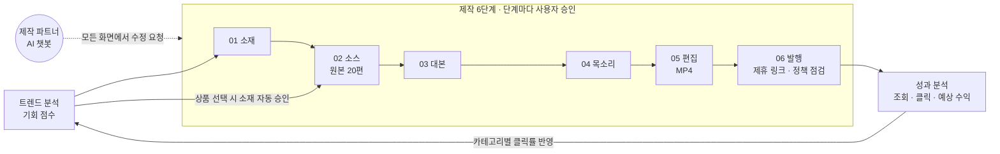

# Shopping-Shorts-Maker

**AI 쇼핑숏츠 제작기**: 제품명 하나로 틱톡·샤오홍슈 원본 영상 20편을 모아, 15·20초 쇼핑 숏폼을 만들고 제휴 링크와 함께 발행하는 6단계 승인형 대시보드입니다.



## 대시보드 화면


| 항목 | 내용 |
| --- | --- |
| 화면 | 로그인 후 기본 화면인 홈, 데스크탑 1440px |
| 출처 | [프로토타입 원본](./design/prototype/Main.dc.html) 렌더링 |
| 데이터 | 시안용 예시 데이터 |

## 문서

| 문서 | 내용 |
| --- | --- |
| [기능 기획서](./docs/planning.md) | 단계별 기능 명세, 소스 검색 20편, 제작 파트너 챗봇, 상태 머신·데이터 모델, 기술 스택·원가, 린 검증·로드맵, 트렌드 분석, 카테고리, 다중 계정, 수익화(P0), 제휴 프로그램·링크인바이오, 구현 전 보강 명세 |
| [디자인 시안](./docs/design.md) | 디자인 토큰, 반응형 3구간과 구간별 폰트 크기, 화면별 구성, 06 발행 화면, 제작 파트너 팝업, 인터랙션 규칙, 구현 메모 |
| [프로토타입 원본](./design/prototype/Main.dc.html) | Claude Design 인터랙티브 프로토타입 소스 |
| [구조도](./docs/diagrams/) | 기능 맵, 사이트맵, 사용자 흐름, 시스템 구성 등 Mermaid 9종 |

## 진행 현황 (2026-11-12 기준)

제작 01~05단계가 실제 데이터로 동작하는 웹 대시보드와 데스크톱 개발용 셸까지 구현했습니다. 06 발행(YouTube)과 운영 배포는 아직입니다. 린 검증(W0) 판정 전이지만 사용자 결정 D12로 W1~W3을 먼저 진행했습니다.

| 영역 | 현재 상태 |
| --- | --- |
| 기능 기획 | 1~17장, 결정 D1~D13(D12 회신 없이 출처 표기로 제작·게이트 전 개발, D13 확장 수집은 열린 탭만·워터마크 있는 본만) |
| 설계(W1) | ADR 5건·데이터 모델·YouTube API 조사 초안(상태 제안), 문서 정합(task-004)은 W0 결과 대기 |
| 기반(W2) | 웹 뼈대·Docker 셀프 호스팅 스택·로그인·DB(RLS·승인 함수)·작업 큐·워커·6단계 상태 머신 **완료** |
| 제작(W3) | 01 소재·03 대본(AI)·02 소스 선정·04 목소리(TTS)·05 편집(MP4 렌더)·홈·트렌드 완료, 확장 수집(015a~d)·제작 파트너(021) 남음 |
| 설치형 앱 | Tauri 데스크톱 개발용 셸 동작(`pnpm tauri dev`), 설치 파일·서명·모바일(Capacitor)은 W7 |
| 시장 검증(W0) | 판매자 연락·제품 촬영·법률 검토 발송은 사용자 진행, 사전예약 폼 계정 연결 대기 |

| 제한 | 내용 |
| --- | --- |
| 권리 | 출처 표기(D7)는 법적 허락이 아닙니다. 법률 검토 회신으로 다시 판단합니다 |
| 실사용 | 크레딧 충전 수단이 없어 실제 사용자는 잔액 0으로 작업이 거부됩니다(가입 지급 여부 결정 대기) |
| 발행 | 06 발행·YouTube 업로드는 W4라 아직 영상을 올릴 수 없습니다 |
| AI 모델 | 테스트용 Gemini 무료 키로만 실호출했습니다. 실무 모델(Claude·OpenAI)·Fish Audio는 미연결 |

### 완성도

| 기준 | 완성도 | 근거 |
| --- | --- | --- |
| 작업 개수 | 17 / 36 (약 47%) | task-015를 015a~d로 나눠 36개. W1 문서 3·W2 7·W3 6·W7 셸 일부 |
| 제작 흐름 | 01~05 동작 | 로그인 → 새 프로젝트 → 소재 → 소스 → 대본 → 음성 → 15.000초 MP4(영상·음성 차 0.000초) |
| 품질 게이트 | 작업마다 독립 보안 리뷰 | 커밋한 작업의 🔴 지적은 모두 반영 후 커밋, SQL 테스트 10종·웹 테스트 165건·워커 테스트 61건 통과 |

### 작업 진행률

| 웨이브 | 내용 | 작업 수 | 완료 | 상태 |
| --- | --- | --- | --- | --- |
| W0 | 시장 검증 | 3 | 0 | 사용자 실측 대기 |
| W1 | 기술설계 | 4 | 3 | 004만 W0 대기 |
| W2 | 기반 | 7 | 7 | 완료 |
| W3 | 제작 01~05·수집·제작 파트너 | 11 | 6 | 015a 진행 중(미커밋), 015b~d·021 남음 |
| W4 | 다중 계정·06 발행·업로드·성과 | 4 | 0 | 다음 |
| W5 | 보안 테스트·E2E | 2 | 0 | 대기 |
| W6 | 운영 배포·베타 | 3 | 0 | 대기 |
| W7 | 설치형 앱 | 2 | 0.5 | Tauri 개발용 셸만 |

### 작업 내역 (2026-11-12)

| 작업 | 결과 | 커밋 |
| --- | --- | --- |
| W1 설계 문서 | ADR 5건(큐·워커·확장 통신·셀프 호스팅·설치형 앱), YouTube API 요건, 데이터 모델·RLS 표 | `92c12eb` `af6f0fe` |
| 회신 없이 제작(D12) | 출처 표기 + 고지 확인 경로, 워터마크 제거 금지 | `8b3b10e` |
| W2 기반 | 웹 뼈대·Docker 스택·로그인·마이그레이션 2묶음·큐·워커·상태 머신 | `a0b571f` `2fabdd0` `a658344` `f344d3c` `084f972` `cc3ed16` `9ce4cf3` |
| UI 피드백 | 토스트·스낵바·알림 대화상자·모달·배너 공용 컴포넌트와 [사용 기준](./docs/ui-feedback.md) | `872ae48` |
| W3 제작 | 홈·트렌드, 01·03 AI, 02 소스 선정·승인 규칙, 04 목소리, 05 편집·렌더 | `5cfac02` `687a826` `ea7d5cb` `968f4f1` `0272a62` `015ec7a` |
| 확장 수집 계획 | 015a~d 분할, ADR-0003 보강, D13 | `d9b14cd` |
| 데스크톱 셸 | Tauri 2.12.5 개발용 창 | `c91f8c0` |

### 다음 세션에서 이어서 할 일

1. **015a 마무리**: 미커밋 `supabase/migrations/20261112240000_extension_collect.sql`·`240100_extension_collect_hardening.sql`(보안 수정 중단됨, 개발 DB에는 적용) — 보안 리뷰 🔴(다운로드 기록 TOCTOU) 수정 확인 → 테스트 → 커밋
2. Tauri 셸 보안 리뷰(커밋 후 시작했다가 중단) 다시 실행
3. 021 제작 파트너 → W4 발행(022~025)
4. 사용자 작업: `.env`에 `WORKER_DB_PASSWORD`·`ENABLE_EMAIL_AUTOCONFIRM=true`, `.env.example` 작성, 가입 크레딧 지급 여부, 확장 연결 화면 추가 승인(015b 선행), 판매자 연락·법률 검토

### 남은 개발 단계

| 순서 | 단계 | 할 일 | 시작 조건 |
| --- | --- | --- | --- |
| 1 | W3 마무리 | 확장 수집(015a~d), 제작 파트너(021) | 015b는 연결 화면 승인 |
| 2 | W4 발행·성과 | YouTube OAuth·Vault, 06 발행·정책 점검, 예약 업로드, 성과 화면 | 크레딧 지급 결정 |
| 3 | W5 QA | 보안 테스트, 6단계 E2E, 3구간 회귀 | W4 완료 |
| 4 | W6 배포·베타 | 운영 서버 셀프 호스팅, 베타 20명·영상 30편 | W5 통과, 00_LEAN 판정 |
| 5 | W7 설치형 앱 | Tauri 설치 파일·서명·자동 업데이트, Capacitor 모바일 | 운영 배포 |

## 콘텐츠 바로가기

| 콘텐츠 | 화면 경로 | 기획·명세 문서 | 구현 코드 |
| --- | --- | --- | --- |
| 구현 전 보강 명세 | - | [17장](./docs/planning.md#17-구현-전-보강-명세) | 없음 |
| 사이트맵 | 전체 메뉴 | [sitemap.mmd](./docs/diagrams/sitemap.mmd) | 없음 |
| 사용자 흐름 | `/trends` → `/studio/[projectId]/[step]` → `/analytics` | [user-flow.mmd](./docs/diagrams/user-flow.mmd) | [apps/web](./apps/web/src/app/(dashboard)) · [apps/worker](./apps/worker/worker) |
| 시스템 구성 | - | [system-architecture.mmd](./docs/diagrams/system-architecture.mmd) | 없음 |
| 설치형 앱 실행 | - | [설치형 앱 실행](#설치형-앱-실행-tauri--capacitor) · [ADR-0005](./docs/adr/0005-installable-app-shell.md) | `apps/desktop`(Tauri 개발용 셸) · 모바일은 W7 |

## 핵심 기능

| 기능 | 설명 |
| --- | --- |
| 트렌드 분석 | 해외 영상 증가 · 국내 검색 증가 · 경쟁도로 기회 점수를 매기고, 고른 상품은 바로 소스 단계로 넘어가 검색이 자동으로 시작됩니다 |
| 6단계 제작 | 단계마다 AI가 결과를 준비하고 사용자가 승인하거나 변경을 요청합니다 |
| 소스 검색 | 틱톡 12편 + 샤오홍슈 8편을 병행 수집하고 출처를 기록합니다 |
| 다중 계정 | 1 프로젝트 = 1 채널, 연결한 채널마다 좌측 메뉴가 생깁니다 |
| 발행·수익화 | 제휴 프로그램 8종, 플랫폼별 링크 삽입 위치, 인포크링크·리틀리 번호 안내, 6항목 정책 점검, 예약 발행 |
| 성과 분석 | 조회 · 링크 클릭 · 예상 수익과 인사이트를 다시 트렌드 점수에 반영합니다 |
| 제작 파트너 | 모든 화면 오른쪽 아래의 팝업 챗봇 |

### 트렌드 분석 순서도


## 화면 규칙

반응형 3구간으로 설계했습니다.

| 구간 | 너비 | 본문 / 제목 폰트 |
| --- | --- | --- |
| 모바일 | ~767px | 14px / 22px |
| 태블릿 | 768~1199px | 15px / 26px |
| 데스크탑 | 1200px~ | 15px / 30px |

## 기술 스택

| 영역 | 기술 |
| --- | --- |
| 웹 | Next.js App Router · React 19 · TypeScript · Tailwind CSS v4 · shadcn/ui |
| DB·인증·파일 | Supabase 셀프 호스팅 (Auth · Postgres · Storage · Realtime · Vault · Queues) |
| 영상 처리 | FFmpeg 워커 컨테이너 |
| 인프라 | Docker Compose, 개발·운영 동일 구성, 자체 서버 운영 |
| LLM | 테스트: Gemini(무료 키) · 실무: Claude/OpenAI(어댑터 자리) |
| 음성 | 테스트: Gemini TTS · 실무: Fish Audio(어댑터 자리) |

## 설치형 앱 실행 (Tauri · Capacitor)

> `apps/desktop`(Tauri)은 **개발용 셸만** 있습니다(서명·자동 업데이트·설치 파일 배포는 W7 task-032). `apps/mobile`(Capacitor)은 아직 없고 W7(task-033)에서 만듭니다. 아래 절차는 확정된 구성([ADR-0005](docs/adr/0005-installable-app-shell.md))을 기준으로 쓴 것이고, 앱을 만든 뒤에 그대로 쓸 수 있습니다.

두 앱 모두 **운영 웹 주소를 여는 셸**입니다. 앱 안에 API 키나 서버 코드가 없으므로, 앱을 실행하기 전에 웹이 먼저 떠 있어야 합니다.

### 0. 웹 먼저 실행 (공통)

```bash
docker compose up -d --wait                  # Supabase·워커 개발 스택
sh docker/migrate.sh up                      # DB 마이그레이션 적용
pnpm install && pnpm dev                     # 웹 http://localhost:3000
```

### 1. 데스크톱 앱 — Tauri 2.12.5

| 준비물 | 설치 |
| --- | --- |
| Rust | [rustup](https://rustup.rs) 설치 후 `rustup default stable` |
| Windows | Visual Studio Build Tools(“C++를 사용한 데스크톱 개발”), WebView2(Windows 11은 기본 포함) |
| macOS | `xcode-select --install` |
| Node·pnpm | 루트 `package.json`의 버전 |

```bash
pnpm tauri dev                               # 개발: http://localhost:3000 을 창으로 연다(첫 실행은 Rust 빌드로 수 분)
pnpm tauri build                             # 설치 파일: Windows .msi/.exe · macOS .dmg (W7에서 번들 설정 후)
```

- 앱이 열 주소는 `APP_WEB_URL` 환경 변수로 바꿉니다(기본 개발 `http://localhost:3000`, 배포 빌드는 운영 주소).
- 창 최소 크기는 1200px(데스크톱 구간)입니다. 외부 링크는 시스템 브라우저로 열립니다.
- 배포용 코드 서명·공증 인증서와 자동 업데이트 서명 키는 CI 비밀에만 둡니다(저장소에 넣지 않음).

### 2. 모바일 앱 — Capacitor 8.6.0

| 준비물 | 설치 |
| --- | --- |
| Android | Android Studio(SDK·에뮬레이터), JDK 21 |
| iOS | macOS + Xcode(시뮬레이터), Apple 개발자 계정(실기기·TestFlight) |

```bash
cd apps/mobile
pnpm install
pnpm exec cap sync                           # 설정·플러그인을 android/ios 프로젝트에 반영
pnpm exec cap run android                    # 에뮬레이터·연결된 기기에서 실행
pnpm exec cap open ios                       # Xcode에서 열어 실행(macOS만)
```

- 앱이 열 주소는 `capacitor.config.ts`의 `server.url`이며 `APP_WEB_URL`로 바꿉니다.
  - Android 에뮬레이터에서 내 PC의 웹: `http://10.0.2.2:3000`
  - 실기기: 같은 와이파이의 PC IP(예: `http://192.168.0.10:3000`), 웹을 `pnpm --filter web exec next dev -H 0.0.0.0`으로 실행
  - iOS 시뮬레이터: `http://localhost:3000`
- `http://` 개발 주소는 개발 빌드에서만 허용합니다(`server.cleartext`). 배포 빌드는 운영 HTTPS 주소만 씁니다.
- 마이크(직접 녹음) 권한 문구: Android `RECORD_AUDIO`, iOS `NSMicrophoneUsageDescription`.
- 로그인: Google은 앱 웹뷰 로그인을 막으므로 이메일 로그인을 쓰고, YouTube 연결(OAuth)은 시스템 브라우저로 열렸다가 앱으로 돌아옵니다.

### 앱에서 하지 않는 것

- 틱톡·샤오홍슈 원본 수집: 앱 웹뷰는 사용자 브라우저 로그인을 쓸 수 없으므로 PC 브라우저 확장으로만 수집합니다.
- 앱에 API 키·비밀 넣기: 모든 키는 서버에만 있습니다.
