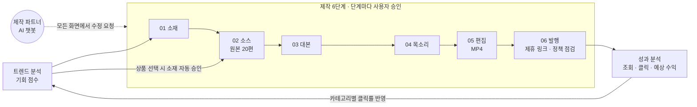
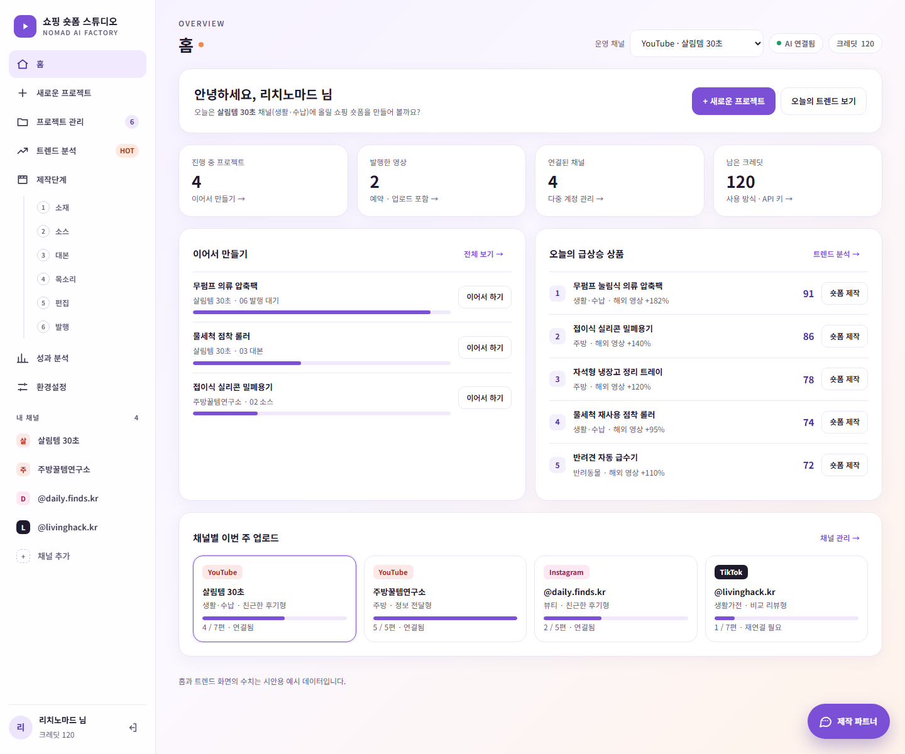

# Shopping-Shorts-Maker

**AI 쇼핑숏츠 제작기**: 제품명 하나로 틱톡·샤오홍슈 원본 영상 20편을 모아, 15·20초 쇼핑 숏폼을 만들고 제휴 링크와 함께 발행하는 6단계 승인형 대시보드입니다.

## 대시보드 화면

| 항목 | 내용 |
| --- | --- |
| 화면 | 로그인 후 기본 화면인 홈, 데스크탑 1440px |
| 출처 | [프로토타입 원본](./design/prototype/Main.dc.html) 렌더링 |
| 데이터 | 시안용 예시 데이터 |

## 문서

| 문서 | 내용 |
| --- | --- |
| [기능 기획서](./docs/planning.md) | 단계별 기능 명세, 소스 검색 20편, 제작 파트너 챗봇, 상태 머신·데이터 모델, 기술 스택·원가, 린 검증·로드맵, 트렌드 분석, 카테고리, 다중 계정, 수익화(P0), 제휴 프로그램·링크인바이오, 구현 전 보강 명세 |
| [디자인 시안](./docs/design.md) | 디자인 토큰, 반응형 3구간과 구간별 폰트 크기, 화면별 구성, 06 발행 화면, 제작 파트너 팝업, 인터랙션 규칙, 구현 메모 |
| [프로토타입 원본](./design/prototype/Main.dc.html) | Claude Design 인터랙티브 프로토타입 소스 |
| [구조도](./docs/diagrams/) | 기능 맵, 사이트맵, 사용자 흐름, 시스템 구성 등 Mermaid 9종 |

## 진행 현황 (2026-11-11 기준)

기획과 디자인 시안 단계이며, 앱 코드는 아직 없습니다.

| 영역 | 현재 상태 |
| --- | --- |
| 기능 기획 | 1~17장 작성, 열린 결정 5건 남음 |
| 디자인 시안 | 프로토타입 완료 |
| 구조도 | Mermaid 9종 작성 |
| 구현 | 시작 전 |

| 제한 | 내용 |
| --- | --- |
| 권리 | 원본 수집과 재편집의 권리 문제는 법률 검토 전입니다 |
| 수치 | 가격과 작업 시간 제한 값은 베타 측정 전 가설입니다 |

### 작업 진행률

작업 분해 전이라 작업 개수 기준 진행률은 아직 없고, 아래 단계별 상태로 관리합니다.

**제품 로드맵 4단계**([기획서 9장](./docs/planning.md#9-린-검증--수익화--로드맵--추천안))

| 단계 | 기간 | 범위 | 상태 |
| --- | --- | --- | --- |
| 1. 시장 검증 | 1~2주 | 랜딩페이지와 사전예약, 반자동 제작 대행 | 시작 전 |
| 2. MVP | 3~6주 | 01 소재~06 발행, 채팅, 성과 분석, 베타 20명·영상 30편 | 시작 전 |
| 3. 유료 전환 | 7~10주 | 크레딧 결제, 스케일업 유료 옵션 | 시작 전 |
| 4. 확장 | 11주~ | 일괄 생성, 화이트라벨, 성과 기반 소재 추천 | 시작 전 |

**개발 절차 9단계**

| 단계 | 상태 |
| --- | --- |
| 01 검증 | 계획만 있음 |
| 02 기획 | 진행 중, 열린 결정 5건 |
| 03 UX · 04 UI | 프로토타입 완료 |
| 05 기술설계 | 다음 단계 |
| 06 구현 · 07 QA · 08 배포 · 09 개선 | 시작 전 |

### 구현된 주요 항목

| 완료 | 항목 |
| --- | --- |
| ☐ | 아직 없음 |

### 다음 개발 단계

| 완료 | 항목 |
| --- | --- |
| ☐ | 열린 결정 D1~D5 확정 |
| ☐ | 작업 분해 |
| ☐ | 프로젝트 생성과 디자인 토큰 이관 |

## 콘텐츠 바로가기

| 콘텐츠 | 화면 경로 | 기획·명세 문서 | 구현 코드 |
| --- | --- | --- | --- |
| 구현 전 보강 명세 | - | [17장](./docs/planning.md#17-구현-전-보강-명세) | 없음 |
| 사이트맵 | 전체 메뉴 | [sitemap.mmd](./docs/diagrams/sitemap.mmd) | 없음 |
| 사용자 흐름 | `/trends` → `/studio/[projectId]/[step]` → `/analytics` | [user-flow.mmd](./docs/diagrams/user-flow.mmd) | 없음 |
| 시스템 구성 | - | [system-architecture.mmd](./docs/diagrams/system-architecture.mmd) | 없음 |

## 핵심 기능

| 기능 | 설명 |
| --- | --- |
| 트렌드 분석 | 해외 영상 증가 · 국내 검색 증가 · 경쟁도로 기회 점수를 매기고, 고른 상품은 바로 소스 단계로 넘어가 검색이 자동으로 시작됩니다 |
| 6단계 제작 | 단계마다 AI가 결과를 준비하고 사용자가 승인하거나 변경을 요청합니다 |
| 소스 검색 | 틱톡 12편 + 샤오홍슈 8편을 병행 수집하고 출처를 기록합니다 |
| 다중 계정 | 1 프로젝트 = 1 채널, 연결한 채널마다 좌측 메뉴가 생깁니다 |
| 발행·수익화 | 제휴 프로그램 8종, 플랫폼별 링크 삽입 위치, 인포크링크·리틀리 번호 안내, 6항목 정책 점검, 예약 발행 |
| 성과 분석 | 조회 · 링크 클릭 · 예상 수익과 인사이트를 다시 트렌드 점수에 반영합니다 |
| 제작 파트너 | 모든 화면 오른쪽 아래의 팝업 챗봇 |

### 트렌드 분석 순서도

## 화면 규칙

반응형 3구간으로 설계했습니다.

| 구간 | 너비 | 본문 / 제목 폰트 |
| --- | --- | --- |
| 모바일 | ~767px | 14px / 22px |
| 태블릿 | 768~1199px | 15px / 26px |
| 데스크탑 | 1200px~ | 15px / 30px |

## 기술 스택(계획)

| 영역 | 기술 |
| --- | --- |
| 웹 | Next.js App Router · React 19 · TypeScript · Tailwind CSS v4 · shadcn/ui |
| DB·인증·파일 | Supabase |
| 영상 처리 | FFmpeg |
| LLM | Claude/OpenAI API |
| 음성 | Fish Audio/ElevenLabs |
