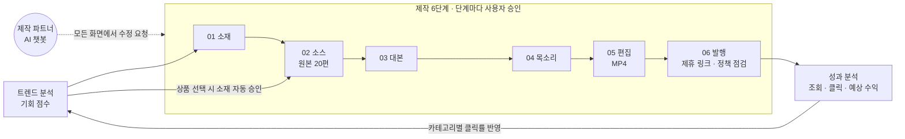
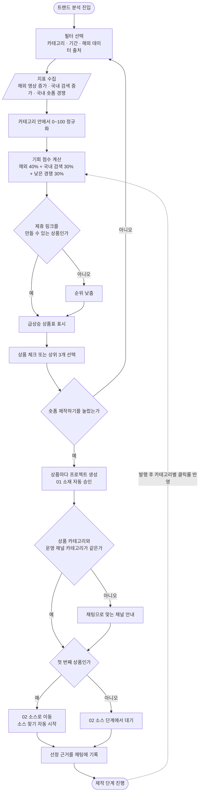

# Shopping-Shorts-Maker

**AI 쇼핑숏츠 제작기**: 제품명 하나로 틱톡·샤오홍슈 원본 영상 20편을 모아, 15·20초 쇼핑 숏폼을 만들고 제휴 링크와 함께 발행하는 6단계 승인형 대시보드입니다.

## 대시보드 화면

| 항목 | 내용 |
| --- | --- |
| 화면 | 로그인 후 기본 화면인 홈, 데스크탑 1440px |
| 출처 | [프로토타입 원본](./design/prototype/Main.dc.html) 렌더링 |
| 데이터 | 시안용 예시 데이터 |

## 문서

| 문서 | 내용 |
| --- | --- |
| [기능 기획서](./docs/planning.md) | 단계별 기능 명세, 소스 검색 20편, 제작 파트너 챗봇, 상태 머신·데이터 모델, 기술 스택·원가, 린 검증·로드맵, 트렌드 분석, 카테고리, 다중 계정, 수익화(P0), 제휴 프로그램·링크인바이오, 구현 전 보강 명세 |
| [디자인 시안](./docs/design.md) | 디자인 토큰, 반응형 3구간과 구간별 폰트 크기, 화면별 구성, 06 발행 화면, 제작 파트너 팝업, 인터랙션 규칙, 구현 메모 |
| [프로토타입 원본](./design/prototype/Main.dc.html) | Claude Design 인터랙티브 프로토타입 소스 |
| [구조도](./docs/diagrams/) | 기능 맵, 사이트맵, 사용자 흐름, 시스템 구성 등 Mermaid 9종 |

## 진행 현황 (2026-11-12 기준)

기획·디자인을 마치고 01 검증(W0) 단계에 있습니다. 서비스 앱 코드는 아직 없고, 시장 검증용 랜딩 페이지와 편집 파이프라인 시험 코드만 있습니다.

| 영역 | 현재 상태 |
| --- | --- |
| 기능 기획 | 1~17장 작성, 결정 D1~D11 확정(출처 표기·원본 20→10→5편·제작 전 예상 비용·테스트/실무 모델·설치형 앱 포함) |
| 디자인 | 프로토타입, 화면 표 S-01~S-16, 화면별 사양·와이어프레임 생성 |
| 구조도 | Mermaid 9종 + 화면 사양에서 자동 생성 5종 |
| 작업 분해 | 33개 작성, W0 진행 중, W1~W7은 린 검증 통과 전까지 보류 |
| 시장 검증(W0) | 테스트 카테고리·기준 확정, 연락 대상 표·단가 조사 완료, Google 키로 대본→음성→영상 실호출 성공, 사용자 실측·랜딩 가입 대기 |
| 서비스 구현 | 시작 전 |

| 제한 | 내용 |
| --- | --- |
| 권리 | 원본 수집과 재편집의 권리 문제는 법률 검토 전입니다 |
| 수치 | 가격, 작업 시간 제한, 예외 승인 3편 하한은 실측 전 가설입니다 |
| 검증 | 사전예약 폼 집계는 아직 확인하지 못했습니다. AI 원가는 테스트 모델(Gemini 무료 키) 기준만 측정했고 실무 모델(Claude·OpenAI)과 Fish Audio는 미측정입니다 |
| 출처 표기 | 원작자 허락 대신 출처 표기 + 고지 확인으로 제작합니다(D7). 출처 표기는 법적 허락이 아니어서 법률 검토 결과로 다시 판단합니다 |

### 완성도

전체 완성도는 작업 개수 기준이며, 단계별 완성도는 산출물 기준 추정입니다.

| 기준 | 완성도 | 근거 |
| --- | --- | --- |
| 작업 개수 | 0 / 31 완료 (0%) | W0의 3개는 AI 준비분을 마치고 사용자 입력 대기라 완료로 세지 않음 |
| 기획·디자인 | 약 95% | 기획서·화면 표·사양 완료, 디자인 토큰 파일은 task-008에서 생성 |
| 시장 검증(W0) | 약 60% | 랜딩·실측 양식·연락 대상 표·단가 조사·파이프라인 실호출 완료, 폼 연결·실측·실무 모델 원가·판정 남음 |
| 서비스 개발(W1~W7) | 0% | 린 검증 통과 후 시작 |

| 개발 절차 | 상태 | 완성도(추정) |
| --- | --- | --- |
| 01 검증 | W0 진행 중 | 약 60% |
| 02 기획 | 결정 확정, 작업 분해 완료 | 100% |
| 03 UX · 04 UI | 프로토타입, [화면 표](./docs/03_SCREENS_UX.md), 사양 완료 | 약 90% |
| 05 기술설계 | W1에서 진행 | 0% |
| 06 구현 | W2~W4에서 진행 | 0% |
| 07 QA | W5에서 진행 | 0% |
| 08 배포 | W6에서 진행 | 0% |
| 09 개선 | 베타 측정 후 | 0% |

### 작업 진행률

근거는 [작업 표](./tasks/README.md)의 작업 개수입니다.

| 웨이브 | 내용 | 작업 수 | 완료 | 상태 |
| --- | --- | --- | --- | --- |
| W0 | 시장 검증: 랜딩·사전예약, 권리 확인 원본 실측, 대행 원가 측정 | 3 | 0 | 진행 |
| W1 | 기술설계: 문서 정합, ADR(셀프 호스팅 포함), 스키마·RLS, YouTube API 조사 | 4 | 0 | 보류 |
| W2 | 기반: Docker 개발 스택, 프로젝트 생성, 인증, 마이그레이션, 큐·워커, 상태 머신 | 7 | 0 | 보류 |
| W3 | 제작 01~05, 소스 수집, 제작 파트너 | 8 | 0 | 보류 |
| W4 | 다중 계정, 06 발행, 업로드, 성과 분석 | 4 | 0 | 보류 |
| W5 | QA: 보안 테스트, E2E, 3구간 회귀 | 2 | 0 | 보류 |
| W6 | 운영 서버 셀프 호스팅, 배포, 베타 측정 | 3 | 0 | 보류 |
| W7 | 설치형 앱: Tauri 데스크톱, Capacitor 모바일, 다운로드 페이지 | 2 | 0 | 보류 |

### 남은 개발 단계

| 순서 | 단계 | 할 일 | 시작 조건 |
| --- | --- | --- | --- |
| 1 | W0 시장 검증 마무리 | 사전예약 폼 연결, 권리 확인 원본 실측, 법률 검토 의뢰, 실제 원가 측정, [린 검증](./docs/00_LEAN.md) 판정 | 사용자 입력(폼 서비스·테스트 카테고리·API 키) |
| 2 | W1 기술설계 | 셀프 호스팅 구성 ADR, 스키마·RLS, YouTube API 요건 조사 | 린 검증 통과 |
| 3 | W2 기반 | Docker Compose 개발 스택, 인증, 마이그레이션, 작업 큐·워커, 단계 상태 머신 | W1 완료 |
| 4 | W3 제작 | 01 소재~05 편집 화면과 처리, 확장 프로그램 수집, 제작 파트너 | W2 완료 |
| 5 | W4 발행·성과 | 다중 계정·OAuth, 06 발행, YouTube 예약 업로드, 성과 분석 | W3 핵심 작업 완료 |
| 6 | W5 QA | 보안 테스트, 6단계 E2E, 3구간 화면 회귀 | W3·W4 완료 |
| 7 | W6 배포·베타 | 운영 서버 셀프 호스팅, 배포, 베타 20명·영상 30편 측정 | W5 통과 |
| 8 | W7 설치형 앱 | Tauri 데스크톱 설치 파일(Windows·macOS), Capacitor 모바일 앱(Android·iOS), 다운로드 페이지 | 웹 대시보드 운영 배포 완료 |
| 9 | 로드맵 3단계 유료 전환 | 크레딧 결제·충전, 스케일업 유료 옵션, YouTube 외 플랫폼 발행 | 베타 지표 확인 |
| 10 | 로드맵 4단계 확장 | 일괄 생성, 화이트라벨, 성과 기반 소재 추천 | 유료 전환 확인 |

**제품 로드맵 4단계**([기획서 9장](./docs/planning.md#9-린-검증--수익화--로드맵--추천안))

| 단계 | 기간 | 범위 | 상태 |
| --- | --- | --- | --- |
| 1. 시장 검증 | 1~2주 | 랜딩페이지와 사전예약, 반자동 제작 대행 | 진행 중 |
| 2. MVP | 3~6주 | 01 소재~06 발행, 채팅, 성과 분석, 베타 20명·영상 30편 | 시작 전 |
| 3. 유료 전환 | 7~10주 | 크레딧 결제·충전, 스케일업 유료 옵션, YouTube 외 플랫폼 발행 | 시작 전 |
| 4. 확장 | 11주~ | 일괄 생성, 화이트라벨, 성과 기반 소재 추천 | 시작 전 |

### 구현된 주요 항목

| 완료 | 항목 |
| --- | --- |
| ☑ | [랜딩·사전예약 페이지](./landing/) (폼 주소 연결 전) |
| ☑ | [편집·원가 파이프라인 시험 코드](./poc/agency/): 테스트용 Google(Gemini) 키로 영상 분석·대본·음성 실호출, 문장 단위 음성·자막 싱크(오차 검사 0.2초), 영상 우하단·설명란 출처 표기, 제작 전 모델별 예상 비용 표, Gemini·Claude 원가 비교 |
| ☑ | [판매자 연락 대상 표](./docs/w0/outreach-list.md), [공식 단가 조사](./docs/w0/pricing-research.md), [랜딩 도구 추천](./docs/w0/landing-tools.md) |
| ☑ | 프로토타입 반영: 02 소스 출처 표기 고지·경고 메일 대처 팁, 20편 검색→10편 다운로드→5편 사용, 새 프로젝트·트렌드 화면의 모델별 예상 비용 |
| ☑ | [권리 확인 원본 실측 양식](./docs/w0/source-rights-survey.md), [법률 검토 의뢰서 초안](./docs/w0/legal-review-request.md) |

### 작업 내역 (2026-11-12)

| 순서 | 작업 | 결과 | 커밋 |
| --- | --- | --- | --- |
| 1 | 테스트 카테고리 확정 | 압축팩·밀폐용기·보풀제거기, 회신 10일·구입비 상한·클립 2초 기준 | `0134777` |
| 2 | 원작자 허락 → 출처 표기(D7) | 02 소스 노란 고지 + 확인 체크, 경고 메일 대처 팁 7단계, 워터마크 제거 금지 | `0134777` |
| 3 | 원본 흐름(D8) | 20편 검색(목록) → 10편 다운로드 → 5편 사용, 검증 기준 ② 5편 | `0134777` `0a9a46b` |
| 4 | 제작 전 예상 비용(D9) | 새 프로젝트·트렌드 화면에 모델 조합별 금액(최저 약 27원 / 추천 약 102원 / Claude만 약 653원) | `0134777` `77d0003` |
| 5 | 판매자 연락 대상 표 | 제품별 5곳, 공식 영상 확인 3곳, 요청 메시지 초안 | `0a9a46b` |
| 6 | 공식 단가·랜딩 도구 조사 | Gemini·Claude·Fish Audio 단가, Formspree + Umami 추천 | `77d0003` |
| 7 | 테스트·실무 모델 구분(D10) | 테스트는 Google(Gemini) 무료 키, 실무는 Claude Sonnet 또는 OpenAI Sol·Terra·Luna | `77d0003` `255601c` |
| 8 | 설치형 앱 계획(D11) | 웹 완성 후 Tauri 데스크톱·Capacitor 모바일(W7, task-032·033) | `93d7faf` |
| 9 | 파이프라인 실호출 | Google 키 하나로 영상 분석 → 대본 → 음성 → 15초 MP4, 보안 리뷰 반영(중복 과금 방지 등) | `5b1a946` `42efd0e` |
| 10 | 음성·자막 싱크 | 문장 단위 싱크, 자동 오차 검사(0.001초), 목소리 후보 샘플 | `a3cde86` |

### 다음 세션에서 이어서 할 일

1. 목소리 확정: `poc/agency/out/listen/` 샘플(Leda·Zephyr·Sadachbia 등) 중 선택 → 무료 한도 회복 후 그 목소리로 최종 확인 영상
2. 작은 수정: 영상 트랙 14.8초와 음성 15.0초 길이 차이
3. 사용자 작업: 판매자 연락·제품 촬영 실측, 랜딩 가입(Formspree·Umami), 법률 검토 발송
4. 실무 모델 키(Claude·OpenAI)·Fish Audio 키를 받으면 원가 비교 → 00_LEAN 판정 → W1 기술설계

### 다음 개발 단계

| 완료 | 항목 |
| --- | --- |
| ☑ | 결정 D1~D11 확정 |
| ☑ | 작업 분해 33개(W7 설치형 앱 Tauri·Capacitor 포함) |
| ☐ | 사전예약 폼 서비스·방문 집계 연결(task-001) |
| ☑ | 테스트 카테고리 3개 확정(압축팩·밀폐용기·보풀제거기), 기준 ② 원본 5편 |
| ☐ | 판매자 연락·자체 촬영 실측, 법률 검토 발송(task-002) |
| ☐ | 목소리 확정(활기찬 20대 여성 후보 Leda·Zephyr·Sadachbia 등), 실무 모델(Claude Sonnet·OpenAI)과 Fish Audio 원가 측정(task-003) |
| ☐ | 린 검증 판정 후 W1 기술설계(task-004~007) |

## 콘텐츠 바로가기

| 콘텐츠 | 화면 경로 | 기획·명세 문서 | 구현 코드 |
| --- | --- | --- | --- |
| 구현 전 보강 명세 | - | [17장](./docs/planning.md#17-구현-전-보강-명세) | 없음 |
| 사이트맵 | 전체 메뉴 | [sitemap.mmd](./docs/diagrams/sitemap.mmd) | 없음 |
| 사용자 흐름 | `/trends` → `/studio/[projectId]/[step]` → `/analytics` | [user-flow.mmd](./docs/diagrams/user-flow.mmd) | 없음 |
| 시스템 구성 | - | [system-architecture.mmd](./docs/diagrams/system-architecture.mmd) | 없음 |

## 핵심 기능

| 기능 | 설명 |
| --- | --- |
| 트렌드 분석 | 해외 영상 증가 · 국내 검색 증가 · 경쟁도로 기회 점수를 매기고, 고른 상품은 바로 소스 단계로 넘어가 검색이 자동으로 시작됩니다 |
| 6단계 제작 | 단계마다 AI가 결과를 준비하고 사용자가 승인하거나 변경을 요청합니다 |
| 소스 검색 | 틱톡 12편 + 샤오홍슈 8편을 병행 수집하고 출처를 기록합니다 |
| 다중 계정 | 1 프로젝트 = 1 채널, 연결한 채널마다 좌측 메뉴가 생깁니다 |
| 발행·수익화 | 제휴 프로그램 8종, 플랫폼별 링크 삽입 위치, 인포크링크·리틀리 번호 안내, 6항목 정책 점검, 예약 발행 |
| 성과 분석 | 조회 · 링크 클릭 · 예상 수익과 인사이트를 다시 트렌드 점수에 반영합니다 |
| 제작 파트너 | 모든 화면 오른쪽 아래의 팝업 챗봇 |

### 트렌드 분석 순서도

## 화면 규칙

반응형 3구간으로 설계했습니다.

| 구간 | 너비 | 본문 / 제목 폰트 |
| --- | --- | --- |
| 모바일 | ~767px | 14px / 22px |
| 태블릿 | 768~1199px | 15px / 26px |
| 데스크탑 | 1200px~ | 15px / 30px |

## 기술 스택(계획)

| 영역 | 기술 |
| --- | --- |
| 웹 | Next.js App Router · React 19 · TypeScript · Tailwind CSS v4 · shadcn/ui |
| DB·인증·파일 | Supabase 셀프 호스팅 (Auth · Postgres · Storage · Realtime · Vault · Queues) |
| 영상 처리 | FFmpeg 워커 컨테이너 |
| 인프라 | Docker Compose, 개발·운영 동일 구성, 자체 서버 운영 |
| LLM | Claude/OpenAI API |
| 음성 | Fish Audio/ElevenLabs |
