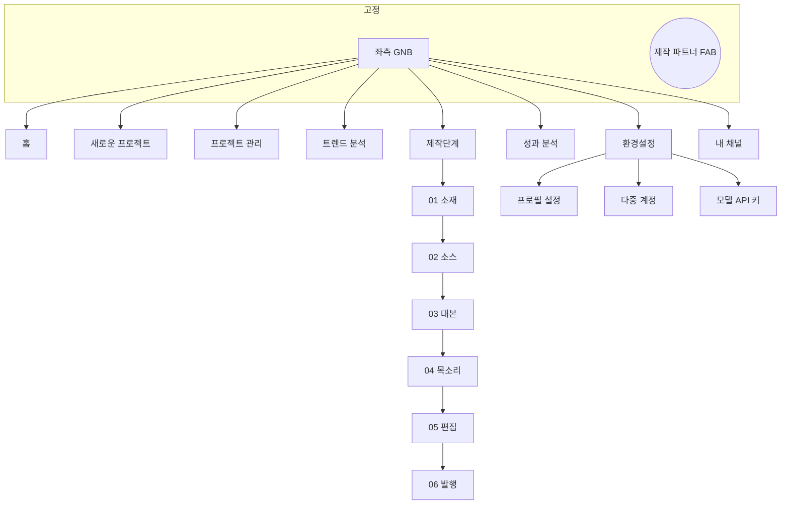
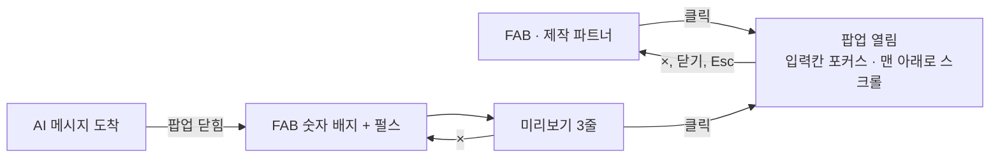

# AI 쇼핑숏츠 제작기 · 디자인 시안

작성: 리치노마드(RichNomad) · 최종 수정 2026-11-11 · 기능 기획서: [planning.md](./planning.md)

- 인터랙티브 프로토타입: [Claude Design 프로토타입](https://claude.ai/artifact/TiGkMmq1y8SBwtZ9dHq2XY)(비공개 링크, 소유자 공유 필요)
- 프로토타입 원본: [`design/prototype/Main.dc.html`](../design/prototype/Main.dc.html)(Claude Design 런타임용 파일이라 브라우저에서 바로 열리지 않습니다)

이 문서는 프로토타입의 화면 구성, 디자인 토큰, 반응형 규칙, 인터랙션을 개발용으로 정리한 것입니다. 기능의 동작 규칙과 데이터 모델은 [기획서](./planning.md)를 따릅니다.

---

## 1. 디자인 원칙

1. **승인형 흐름이 한눈에 보일 것**: 6단계(소재 → 소스 → 대본 → 목소리 → 편집 → 발행)의 진행 상태를 스텝퍼와 상태 배너로 항상 보여 줍니다.
2. **작업 영역은 넓게**: 좌측 GNB만 고정하고, 제작 파트너 채팅은 오른쪽 아래 팝업으로 띄워 콘텐츠 폭을 차지하지 않습니다.
3. **모든 버튼은 반응한다**: hover · 누름 · 진행 중 · 완료 · 비활성 상태를 버튼마다 구분하고, 결과는 토스트로 알립니다.
4. **빈 상태도 설계한다**: 처음 들어온 프로젝트의 소스는 "0편 · 소스 확보 대기"로 시작하고, 검색은 사용자가 시작합니다.
5. **수익과 정책을 같은 화면에서**: 06 발행은 제휴 링크 → 링크 삽입 위치 → 링크인바이오 등록 → 정책 점검 → 발행 설정을 위에서 아래로 한 화면에 둡니다.

---

## 2. 디자인 토큰

### 색상

| 토큰 | 값 | 용도 |
| --- | --- | --- |
| `--accent` | `#7B4FD6` | 주요 버튼, 선택 상태, 진행 바, FAB |
| `--accent-weak` | `#F1EAFE` | 선택 배경, 포커스 링 |
| `--accent-line` | `#D9C9F7` | 선택 테두리, 강조 카드 테두리 |
| `--ink` | `#1F1B2E` | 본문 텍스트, 토스트·선택 바 배경 |
| `--muted` | `#5F5873` | 보조 텍스트 |
| `--line` | `#ECE6F6` | 카드·입력 테두리 |
| 배경 | `linear-gradient(135deg,#F6F1FF,#FBF8FF,#FFF3EA)` | 앱 전체 배경 |
| 성공 | `#E3F5EB` / `#1A6E46` | 통과·완료 배지 |
| 주의 | `#FFF4D6` / `#7A4E00` | 대기·확인 필요 배지 |
| 위험 | `#FDE8E8` / `#B42318` | 경쟁 높음·클릭 안 됨 배지 |
| 알림 | `#E2553D` | FAB 새 메시지 배지 |

플랫폼 태그는 YouTube · Instagram · TikTok · 샤오홍슈마다 고유색 배지(`pt-yt`, `pt-ig`, `pt-tt`, `pt-xhs`)를 씁니다.

### 타이포그래피

- 글꼴: **Noto Sans KR**(400 · 500 · 600 · 700), 대체 `system-ui`
- 줄 간격 1.55, 숫자는 `font-variant-numeric: tabular-nums`

### 모양

| 요소 | 값 |
| --- | --- |
| 카드 | 흰 배경, 테두리 1px `--line`, 반경 20px, 그림자 `0 6px 24px rgba(91,60,160,.06)` |
| 버튼 | 높이 44px(작은 버튼 36px), 반경 12px(작은 버튼 10px) |
| 입력칸 | 높이 44px, 반경 12px, 포커스 시 `--accent` 테두리 |
| 배지 | 반경 999px, 11.5px 굵게 |
| 터치 영역 | 최소 44×44px |

---

## 3. 반응형 규칙 (3구간)

| 구간 | 너비 | GNB | 작업 영역 | 제작 파트너 |
| --- | --- | --- | --- | --- |
| 데스크탑 | 1200px~ | 248px 고정 | 좌측 여백 248px, 안쪽 여백 28px 36px | 오른쪽 아래 팝업, 폭 400px |
| 태블릿 | 768~1199px | 216px 고정 | 좌측 여백 216px, 1열 배치, 소스 2열 | 오른쪽 아래 팝업, 폭 380px |
| 모바일 | ~767px | 72px 아이콘 레일 | 좌측 여백 72px, 1열, 단계 탭 가로 스크롤, 소스 1열 | 화면 높이 88% 바텀 시트 + 어두운 배경 |

### 구간별 폰트 크기

| 토큰 | 용도 | 데스크탑 | 태블릿 | 모바일 |
| --- | --- | --- | --- | --- |
| `--fs-base` | 본문 | 15px | 15px | 14px |
| `--fs-sm` | 버튼·입력·채팅 | 13px | 13px | 12.5px |
| `--fs-xs` | 보조·배지·라벨 | 12px | 12px | 11.5px |
| `--fs-h` | 페이지 제목 | 30px | 26px | 22px |
| `--fs-app` | 앱 제목 | 26px | 24px | 20px |

- 하단 여백은 FAB 높이만큼 늘립니다(데스크탑 112px · 태블릿 104px · 모바일 96px).
- `prefers-reduced-motion: reduce`이면 모든 애니메이션과 전환을 끕니다.

---

## 4. 화면 구조

### 좌측 GNB

- 순서: 서비스명 → **홈 · 새로운 프로젝트 · 프로젝트 관리(개수) · 트렌드 분석(HOT) · 제작단계 · 성과 분석 · 환경설정** → 내 채널 → 프로필·크레딧·로그아웃
- 제작단계 하위 6개(소재 · 소스 · 대본 · 목소리 · 편집 · 발행)는 항상 보이고, 승인된 단계에는 ✓가 붙습니다.
- 환경설정 하위 3개(프로필 설정 · 다중 계정 · 모델 API 키)는 환경설정에 있을 때만 펼칩니다.
- **내 채널**: 연결된 계정마다 메뉴 1개(첫 글자 아바타 + 채널명)가 생기고, 새로 추가한 채널은 잠깐 강조 애니메이션을 줍니다. 아래에 "채널 추가" 버튼이 있습니다.
- 현재 메뉴는 `aria-current="page"`로 표시합니다.

### 상단 바

현재 메뉴의 eyebrow와 제목, 운영 채널 선택, AI 연결 상태, 남은 크레딧을 보여 줍니다.

---

## 5. 화면별 구성

### 5-1. 홈

| 영역 | 내용 |
| --- | --- |
| 인사 | "안녕하세요, ○○ 님" + 지표 카드 4개(진행 중 · 발행 대기 · 이번 주 업로드 · 크레딧) |
| 이어서 만들기 | 최근 프로젝트 목록(상태 배지 · 단계 · 채널), 누르면 그 단계로 열림 |
| 오늘의 급상승 상품 | 기회 점수 상위 5개, 바로 "숏폼 제작" |
| 채널별 이번 주 업로드 | 채널마다 진행 바(업로드 / 목표) |

### 5-2. 새로운 프로젝트

4단계 폼: ① 어느 채널에 올릴까요? ② 카테고리(10개) ③ 어떻게 시작할까요?(트렌드에서 고르기 · 제품명 직접 입력 · 상품 URL) ④ 영상 설정(길이 **15초 · 20초**, 업로드 플랫폼). 트렌드에서 고르기를 고르면 트렌드 분석 화면으로 이동합니다.

### 5-3. 프로젝트 관리

필터(전체 · 진행 중 · 발행 대기 · 예약됨 · 업로드됨), 검색, 표(이름 · 카테고리 · 채널 · 단계 · 상태 · 수정일 · 열기/복제/삭제).

### 5-4. 트렌드 분석

- 필터: 카테고리 · 기간(오늘 · 7일 · 30일) · 해외 데이터 출처(전체 · 틱톡 · 샤오홍슈)
- 요약 카드 3개: 가장 기회가 큰 카테고리(평균 기회 점수), 해외 선행 상품 수(해외 영상 +100% 이상 · 국내 경쟁 낮음), 평균 해외 영상 증가(선택한 기간 · 카테고리 기준)
- **급상승 상품 TOP 표**: 행마다 체크박스, 해외 영상 증가율, 국내 검색 증가율, 경쟁(낮음/보통/높음 배지), 7일 스파크라인, 기회 점수 막대
- **선택 바**(하단 고정, 어두운 배경): "N개 선택 · 상품명…" + 선택 해제 + **숏폼 제작하기**(빛나는 강조). 오른쪽은 FAB 자리만큼 비웁니다
- 상위 3개 자동 선택 버튼
- 카테고리별 기회 점수 막대 목록(누르면 그 카테고리로 필터)
- "숏폼 제작하기"를 누르면 01 소재를 자동 승인하고 **02 소스로 이동해 소스 찾기를 자동으로 시작**합니다

### 5-5. 내 채널 (채널별 화면)

채널 헤더(아바타 · 플랫폼 · 카테고리 · 말투 · 연결 상태), 지표 카드 4개, 이 채널의 프로젝트, 이 채널 카테고리의 급상승 상품 3개, 최근 영상 성과.

### 5-6. 제작단계 공통

1. **현재 프로젝트 줄**: 카테고리 태그 · 프로젝트명 · 채널 · 저장 시각 · 프로젝트 삭제 · 처음부터 다시
2. **"쇼핑쇼츠 제작단계" 스텝퍼**: 완료 수와 진행 바, 단계 번호 원(대기 회색 · 현재 강조 · 승인 ✓)
3. **상태 배너**: 대기 · 진행 중(초 단위 경과) · AI 제안 · 준비 완료 · 변경 요청 · 승인
4. **단계 작업 카드**(아래 표)
5. **하단 액션**: 그대로 진행·승인 / 변경 필요 / 다음 단계

| 단계 | 작업 카드 |
| --- | --- |
| 01 소재 | 추천 소재 후보 3개(선정 근거 · 비슷한 영상 링크), 직접 입력, 다른 후보 추천 |
| 02 소스 | 처음에는 **0편 빈 상태 + 소스 찾기**. 검색하면 틱톡 + 샤오홍슈 병행 탐색 진행 표시 → 20편 카드 그리드(번호 · 플랫폼 · 해상도 · 길이 · 체크 · 미리보기), 플랫폼 필터 |
| 03 대본 | 문장별 편집, 예상 길이 미터(15~20초 목표), 문장별 초, 추천 대본 적용 |
| 04 목소리 | 목소리 6종 카드(미리 듣기), 단어 칩을 눌러 쉼 넣기, 음성 생성, 직접 녹음 |
| 05 편집 | 9:16 미리보기, 대사와 장면 연결표(컷 타임라인), 스케일업 · 자막 제거, MP4 출력 · 버전(V1, V2…) |
| 06 발행 | 아래 5-7 |

**권고안 문구**([기획서 17-2](./planning.md#17-2-열린-결정)). 기존 안내 문단과 배너 문장만 사용하며, 레이아웃은 바꾸지 않습니다.

| 위치 | 문구 | 근거 |
| --- | --- | --- |
| 02 소스 안내 문단 | 자동으로 찾은 영상은 참고용·권리 미확인 상태입니다. 판매자 제공·자체 촬영·사용 허락을 받은 원본만 체크해 편집에 쓰세요. 원본 파일은 발행 30일 뒤 삭제하고 출처 기록만 남깁니다. | D1 · D5(30일은 가설) |
| 02 소스 결과 안내 | 사용하지 않을 영상과 권리를 확인하지 않은 영상은 체크를 해제해 주세요. | D1 |
| 02 소스 대기 배너 | 현재 0편 확보 · 최소 7편 목표. 브라우저 확장 프로그램을 연결한 뒤 소스 찾기를 눌러 주세요. | D2 |
| 06 발행 원본 사용 권리 설명 | 참고용·권리 미확인 원본은 빼고, 판매자 제공·자체 촬영·사용 허락을 받은 원본인지 직접 확인합니다 | D1 |

### 5-7. 06 발행

| 카드 | 구성 |
| --- | --- |
| 제휴 프로그램 | 8개 선택 카드(쿠팡 파트너스 · 네이버 쇼핑 커넥트 · 오늘의집 큐레이터 · 무신사 큐레이터 · 올리브영 쇼핑 큐레이터 · 유튜브 쇼핑 상품 태그 · 알리익스프레스 · 사용 안 함), 카테고리·채널에 맞으면 "추천" 배지. 링크 입력 + 자동 찾기, 고지 문구 스위치, 고정 댓글 구매 안내 스위치 |
| 링크 삽입 위치 | 채널 플랫폼별로 사용 · 조건부 · 보조 · **클릭 안 됨** 배지와 설명 |
| 링크인바이오 등록 | 서비스 선택(인포크링크 · 리틀리 · 링크트리 · 사용 안 함), 번호 박스, 등록 내용, 항목 내용 복사, 등록 완료 스위치, "프로필 링크 N번" 자막·설명 스위치 |
| 제목 · 설명 · 해시태그 | 제목(100자 카운터), 설명, 태그, 다시 만들기, 설명 미리보기(고지 → 구매 안내 → 본문 → 태그) |
| 권리 · 정책 점검 | 6개 항목(원본 출처 · 원본 사용 권리 · 새로 만든 요소 · 금지·과장 표현 · 제휴 고지 · 구매 경로), "N / 6 통과" 진행 바 |
| 발행 설정 | 예약 발행 / 지금 올리기, 추천 시간 3개, 발행 버튼(6개 모두 통과해야 활성) |

### 5-8. 성과 분석

채널 필터, 지표 카드 4개(조회수 · 링크 클릭 · 클릭률 · 예상 제휴 수익), 최근 14일 조회 막대 그래프(마지막 날 강조, 막대마다 툴팁), 영상별 성과 표("훅 우수" 표시), 인사이트 카드 3개.

### 5-9. 환경설정

| 탭 | 구성 |
| --- | --- |
| 프로필 설정 | 이름 · 이메일 · 기본 말투 · 언어 · 자막 스타일 · 기본 길이(15초/20초), 알림(작업 완료 · 주간 리포트) |
| 다중 계정 | 연결된 계정 카드(플랫폼 · 카테고리 · 말투 · 주간 목표 진행 바 · 재연결 · 현재 채널로 · 삭제), 계정 추가 폼(플랫폼 · 채널명 · 카테고리 · 말투). 추가하면 좌측 "내 채널"에 메뉴가 생김 |
| 모델 API 키 | 사용 방식(플랫폼 크레딧 / 내 API 키), 제공사별 키 입력 · 저장 · 연결 테스트(뒤 4자리만 표시) |

---

## 6. 제작 파트너 팝업

- **FAB**: 오른쪽 아래 고정, 높이 56px(모바일 52px), 아이콘 + "제작 파트너" 라벨(모바일은 아이콘만). 열려 있으면 ×로 바뀝니다.
- **팝업**: 헤더(제작 파트너 · AI CHAT · 닫기), 맥락 줄(단계 · 채널 · 카테고리 · 말투), 메시지(나 · 화면 선택 / 나 · 직접 입력 / 제작 파트너 / 적용 버튼), 빠른 요청 칩 3개, 입력칸(Enter 전송 · Shift+Enter 줄바꿈 · + 첨부), "크레딧 차감" 안내.
- **열림 애니메이션**: 아래에서 12px 올라오며 0.97 → 1 확대, 0.22초.
- **모바일**: 어두운 배경 위 바텀 시트(위쪽 모서리 20px), 배경을 누르면 닫힘.
- 접근성: `role="dialog"`, FAB `aria-expanded`·`aria-controls`, 닫으면 포커스를 FAB로 되돌림, 메시지 영역 `aria-live="polite"`.

---

## 7. 인터랙션 규칙

| 상태 | 표현 |
| --- | --- |
| hover | 카드·선택지 2px 위로 + 그림자, 버튼 테두리 강조 |
| 누름 | 0.96~0.98 축소 |
| 진행 중 | 버튼 안 스피너 + "○○ 중…" 라벨, 배너에 경과 초 |
| 완료 | 버튼이 "✓ 완료" 상태로 바뀌고 토스트(하단 가운데, 어두운 배경) |
| 다음 행동 | 눌러야 할 버튼에 빛나는 강조(`glow`) |
| 비활성 | 연보라 배경, 이유를 바로 아래 안내 문구로 표시 |
| 선택 | `aria-pressed`, 보라 테두리 + 연보라 배경 |
| 스위치 | `role="switch"`, `aria-checked` |
| 포커스 | 2px `--accent` 외곽선 |

---

## 8. 개발 구현 메모

- 권장 스택: Next.js App Router · React 19 · TypeScript · Tailwind CSS v4 · shadcn/ui · Supabase(Auth · DB · Realtime · Vault)
- 디자인 토큰은 Tailwind `@theme` 변수로 옮기고, 폰트 크기 3구간은 `--fs-*` 변수를 미디어 쿼리에서 바꿉니다.
- 레이아웃: `app/(dashboard)/layout.tsx`에 고정 GNB + `<ChatFab />`(전역), 각 메뉴는 라우트(`/`, `/new`, `/projects`, `/trends`, `/channels/[id]`, `/studio/[projectId]/[step]`, `/analytics`, `/settings/[tab]`)로 나눕니다.
- 단계 상태는 서버(`projects.step_status`)에 두고 Realtime으로 배너를 갱신합니다.
- 컴포넌트 후보: `Gnb`, `StepStepper`, `StatusBanner`, `TrendTable`, `SelectionBar`, `SourceGrid`, `ScriptEditor`, `VoicePicker`, `CutTimeline`, `AffiliatePicker`, `LinkPlacement`, `LinkInBioCard`, `PolicyChecklist`, `PublishPanel`, `ChatFab`, `ChatPopup`, `Toast`
