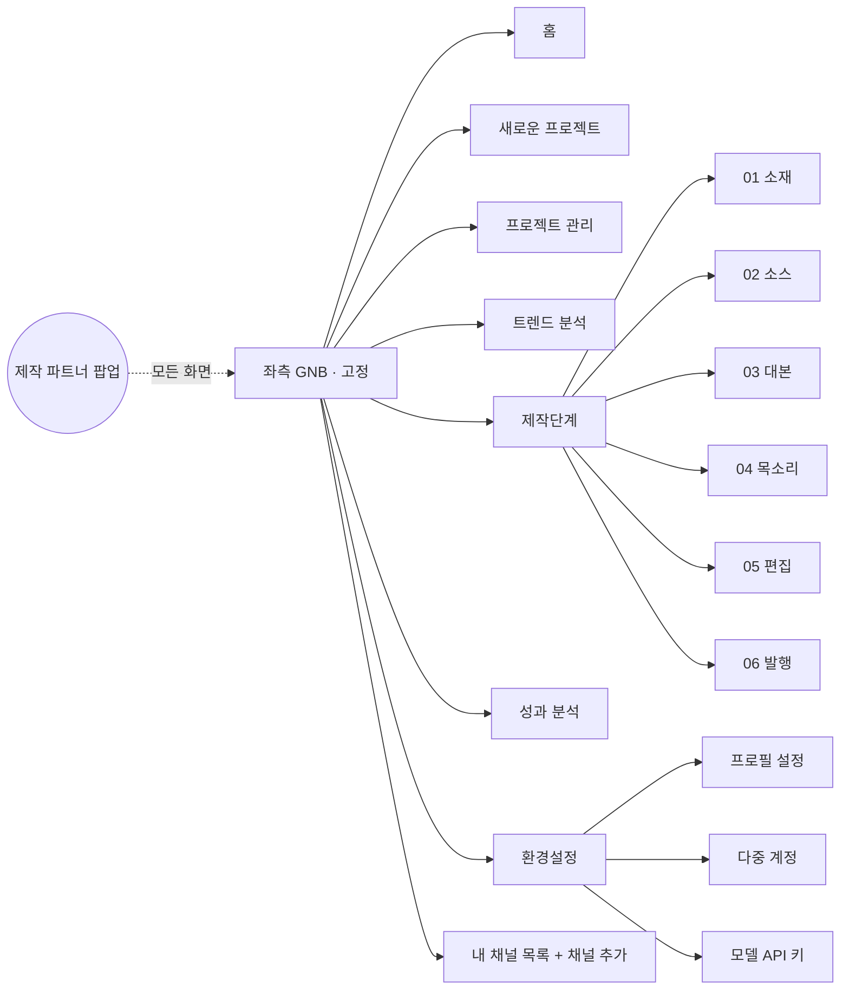
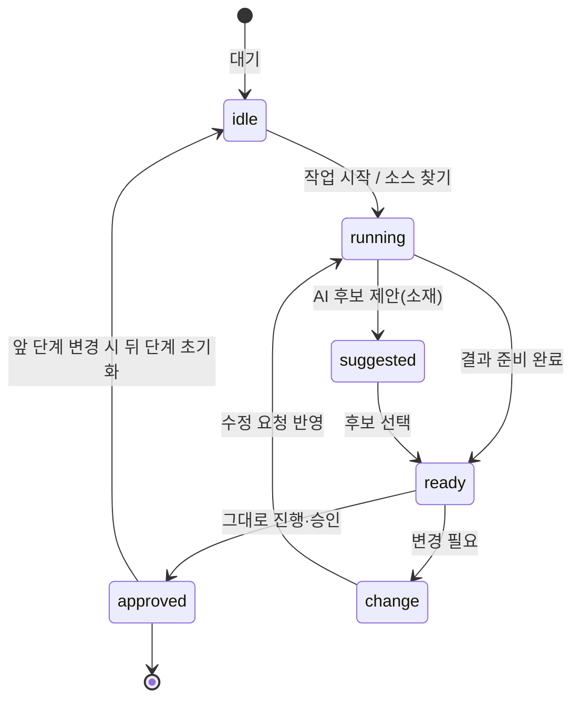
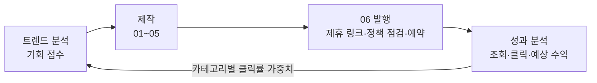

# AI 쇼핑숏츠 제작기 기능 기획서

작성: 리치노마드(RichNomad) · 최종 수정 2026-11-11 · 디자인 시안: [design.md](./design.md)

## 1. 개요

AI 쇼핑숏츠 제작기는 제품명 하나로 틱톡·샤오홍슈 원본 영상 20편을 검색해 그중 10편을 받아, 15\~20초 쇼핑 숏폼 1편을 만드는 6단계 승인형 대시보드입니다(소재 → 소스 → 대본 → 목소리 → 편집 → 발행). 단계마다 AI가 결과를 준비하면 사용자가 "그대로 진행·승인" 또는 "변경 필요"를 고르고, 오른쪽 아래 제작 파트너 팝업으로 언제든 수정을 요청합니다. 화면 시안은 [디자인 프로토타입](https://claude.ai/artifact/TiGkMmq1y8SBwtZ9dHq2XY)에서 직접 눌러 볼 수 있습니다.

**핵심 원리(짜깁기 재편집)**

1. 원본 영상 20편을 목록으로 검색하고, 그중 10편을 내려받아 5편을 사용합니다(17-2 D8). 새 프로젝트로 처음 들어오면 0편 빈 상태이고, "소스 찾기"를 누르거나 트렌드에서 "숏폼 제작하기"로 들어올 때만 검색이 시작됩니다.
2. 대본 한 문장마다 그 내용이 실제로 보이는 구간을 원본에서 1컷씩 잘라냅니다.
3. 컷 ①\~⑤를 이어 붙여 15\~20초 세로 영상(9:16)을 만듭니다.
4. 대본으로 만든 음성(내레이션)과 한 줄 자막을 얹어 MP4로 출력합니다.

**레퍼런스 대비 기획 차이**

| 영역 | 레퍼런스(쇼핑 숏폼 스튜디오) | 이번 기획 |
| --- | --- | --- |
| 단계 | 소재 → 소스 → 대본 → 목소리 → 편집, 단계별 승인 | 동일 + 채널 카드(말투·타깃), 업로드 준비 |
| 소재 | 채팅 AI가 틱톡·샤오홍슈 내부 검색 후 후보 제안 | 후보 3개 + 선정 근거 + 비슷한 영상 링크 3편 |
| 소스 | 20편 검색 → 10편 다운로드 → 5편 사용, 최대 3회 탐색 | 동일 + 플랫폼 필터, 자동 제외 사유 표시 |
| 대본 | 원본 분석 후 5문장 내레이션 | + 예상 길이 미터(목표 15\~20초), 문장별 초 |
| 목소리 | Fish Audio 샘플 6종(전체 100종), 단어별 쉼 편집 | 동일 + 직접 녹음 |
| 편집 | 스케일업, 자막·자국 제거, MP4 출력, 버전 관리 | + 대사와 장면 연결표(컷 타임라인) |
| 채팅 | 화면에서 누른 동작이 메시지로 자동 기록 | + 빠른 요청 칩, 단계 맥락 표시 |

## 2. 화면 구조

대시보드는 왼쪽 메뉴(GNB)와 오른쪽 작업 영역으로 나뉩니다. 메뉴는 홈 → 새로운 프로젝트 → 프로젝트 관리 → 트렌드 분석 → 제작단계 → 성과 분석 → 환경설정 순서이고, 그 아래에 내 채널 목록이 붙습니다. 메뉴는 왼쪽에 고정되어 스크롤해도 그대로 있고, 제작 파트너는 모든 화면 오른쪽 아래의 떠 있는 버튼으로 여닫는 팝업이라 작업 영역의 폭을 차지하지 않습니다.



제작단계의 하위 메뉴 6개는 항상 보이고, 환경설정의 하위 메뉴 3개는 환경설정을 열었을 때만 펼쳐집니다.

- **좌측 GNB**: 서비스명, 메뉴 7개(프로젝트 관리에는 프로젝트 수, 트렌드 분석에는 HOT 배지), 제작단계 하위 메뉴 6개(승인된 단계는 ✓), 성과 분석, 환경설정 하위 메뉴 3개, 내 채널 목록(계정마다 메뉴 1개 + 채널 추가), 맨 아래 프로필·남은 크레딧·로그아웃. 화면 왼쪽에 고정되고, 메뉴가 많으면 메뉴 안에서만 스크롤됩니다
- **상단 바**: 현재 메뉴 제목, 운영 채널 선택(다중 계정 중 지금 작업할 채널), AI 연결 상태, 남은 크레딧. 예전 헤더의 채널 카드는 환경설정 › 다중 계정으로 옮겨, 계정마다 카테고리와 말투를 따로 정합니다
- **현재 프로젝트 줄**(제작단계 안): 카테고리 태그, 프로젝트명, 채널·저장 시각, 프로젝트 삭제, 처음부터 다시. 첫 화면의 프로젝트 선택 드롭다운과 이름 입력칸은 삭제하고, 프로젝트는 새로운 프로젝트·프로젝트 관리 메뉴에서 만들고 엽니다
- **6단계 탭**: "쇼핑쇼츠 제작단계" 제목, 완료 단계 수와 진행 바, 번호 원·단계명·상태를 잇는 스텝퍼. 실제 서비스에서는 승인된 단계까지만 이동하고, 시안에서는 모든 단계를 예시 데이터로 미리 볼 수 있습니다
- **상태 배너**: 현재 단계의 상태를 한 줄로 알려 주고, 진행 중일 때는 경과 시간을 초 단위로 보여 줍니다
- **작업 영역**: 단계 번호(STEP 0N / 06), 단계 제목, 설명, 상태 배지, 단계별 카드
- **하단 바**: 안내 문구와 "다음 단계 →" 버튼(승인 후 활성화), 마지막 06 발행 단계에서는 발행 후 "성과 분석 보기 →"
- **모바일 GNB**: 모바일에서도 왼쪽에 고정된 72px 아이콘 레일로 남습니다. 메뉴 이름은 아이콘 아래 작은 글씨로, 제작단계 하위 메뉴는 번호 원으로, 내 채널은 머리글자 아이콘으로 보여 주고, 태블릿에서는 폭을 216px로 줄입니다

**반응형 3구간과 구간별 글자 크기**

| 구간 | 너비 | 레이아웃 | 본문 | 보조·라벨 | 단계 제목 | 서비스명 |
| --- | --- | --- | --- | --- | --- | --- |
| 모바일 | \~767px | 1열, 단계 탭 가로 스크롤, 소스 1열, 채팅은 화면 높이 88%의 바텀 시트 | 14px | 12.5px / 11.5px | 22px | 20px |
| 태블릿 | 768\~1199px | 1열, 소스 2열, 채팅은 오른쪽 아래 팝업(폭 380px) | 15px | 13px / 12px | 26px | 24px |
| 데스크탑 | 1200px\~ | 작업 영역 전체 폭, 소스 3열, 채팅은 오른쪽 아래 팝업(폭 400px) | 15px | 13px / 12px | 30px | 26px |

버튼·입력칸·탭은 모든 구간에서 터치 영역 44px 이상을 유지합니다.

**버튼 인터랙션 규칙**

- 모든 버튼: 마우스를 올리면 살짝 떠오르고, 누르면 눌림과 물결 효과가 나며, 키보드 포커스 링을 표시합니다
- 오래 걸리는 버튼(소스 찾기·대본 초안·음성 생성·MP4 만들기): 누르는 순간 회전 아이콘과 "…중" 문구로 바뀌고, 상태 배너 아래에 진행 막대가 흐릅니다
- 승인 버튼: 승인되면 초록색 "✓ 승인됨"으로 튀어 오르며 바뀌고, "다음 단계 →" 버튼이 빛나며 다음 행동을 안내합니다
- 결과 알림: 저장·승인·완료마다 화면 아래에 2.4초 동안 알림을 띄웁니다
- 재생 버튼: 소스 영상·목소리 샘플·완성 음성·검토본 모두 재생/일시정지가 바뀌고 진행 막대가 움직입니다
- 채팅: 새 메시지는 아래에서 미끄러져 나타나고, AI 답변 전에는 "입력 중" 점 3개가 표시됩니다
- 움직임 줄이기 설정을 켠 사용자에게는 애니메이션을 끕니다

**상태 배너 5종**

| 상태 | 색 | 제목 예시 | 사용자 할 일 |
| --- | --- | --- | --- |
| 대기 | 흰 바탕, 연보라 테두리 | 소재 준비 대기 / 소스 확보 대기 | 버튼을 눌러 작업 시작 |
| 진행 중 | 연보라 바탕, 회전 아이콘, 경과 초 | 틱톡·샤오홍슈 내부 검색 중 | 기다리기(채팅은 계속 가능) |
| AI 제안 도착 | 연노랑 바탕 | AI 제안 도착 · 적용 필요 | 후보 선택 또는 채팅 제안 적용 |
| 승인 필요 | 연노랑 바탕 | 결과 준비 완료 · 승인 필요 | 그대로 진행·승인 / 변경 필요 |
| 승인 완료 | 연초록 바탕, 체크 | 소재 승인 완료 | 다음 단계로 이동 |

## 3. 단계별 기능 명세

모든 단계는 같은 규칙을 따릅니다. AI가 결과를 준비하면 "승인 필요"가 되고, 승인해야 다음 단계 탭과 "다음 단계 →" 버튼이 열립니다. "변경 필요"를 누르면 채팅으로 수정 내용을 받고, 다시 승인할 수 있습니다.

**제작 전 AI 예상 비용(모델별)**: 숏폼 제작을 시작하기 전에 항상 영상 1편의 AI 예상 비용을 모델 조합별로 보여 줍니다(17-2 D9). 보여 주는 곳은 새로운 프로젝트(S-02)의 "프로젝트 만들기" 위 표, 트렌드(S-04) 선택 바의 한 줄 요약(× 선택 편수)입니다. 행은 조합(최저: Gemini 대본 + Gemini 영상 분석 / 추천: Claude 대본 + Gemini 영상 분석 / Claude만), 열은 대본·소재·채팅 모델, 원본 분석 모델(썸네일 20장 + 영상 10편), 예상 금액(정수 원)입니다. 음성·렌더링·선택 기능은 공통 별도 줄로 둡니다. 금액은 7장 원가 구조의 사용량 × 모델 API 키 설정(S-15)의 단가로 계산하고, 단가가 비어 있으면 "단가 입력 전"으로 표시합니다

### 01 소재 고르기

- **소재 추천받기**: 누르면 채팅에 요청 문장이 자동으로 들어가고, AI가 틱톡·샤오홍슈를 검색해 후보 3개를 제안합니다. 후보마다 선정 근거(후킹 포인트)와 비슷한 영상 링크 3편을 붙입니다
- **사진으로 시작하기**: 상품 사진을 올리면 이미지 인식으로 제품명과 카테고리를 추정해 같은 흐름으로 검색합니다
- **샤오홍슈 로그인 연결**: 연결하면 샤오홍슈 검색 정확도가 올라갑니다. 연결 없이도 틱톡 검색은 동작합니다
- **추천 소재 선택**: 후보 칩을 누르면 "이번 영상에서 다룰 제품" 칸이 자동으로 채워지고, 직접 고쳐 쓸 수 있습니다
- **소재 저장 → 승인**: 저장하면 "결과 준비 완료 · 승인 필요"로 바뀝니다
- **승인 조건**: 제품명이 비어 있지 않을 것

### 02 소스 모으기

- **승인된 소재로 소스 찾기**: 틱톡·샤오홍슈를 병행 검색해 원본 20편을 **목록**(썸네일·제목·길이·해상도·작성자)으로 가져옵니다. 이 단계에서는 파일을 받지 않습니다(상세 규칙은 4장)
- **결과 카드**: 2\~3열 그리드. 영상 미리보기, 번호, 플랫폼 배지(TikTok / 小红书), 한 줄 제목, 해상도·길이, 출처(@작성자), 체크박스. 제작 파트너가 점수 상위 10편을 골라 체크해 두고 사용자가 바꿀 수 있습니다(17-2 D7). **체크한 10편만 내려받아** 카드에 "다운로드됨"으로 표시하고, 나머지는 "목록만"으로 둡니다(D8)
- **사용 선택**: 내려받은 원본의 실제 화질·동작 장면을 보고 편집에 쓸 5편을 고릅니다. 저화질·장면 불일치로 부족하면 남은 목록에서 더 내려받습니다
- **플랫폼 필터**: 전체 / TikTok / 샤오홍슈 개수를 보여 주고 걸러 봅니다
- **원본 영상 추가**: 사용자가 직접 찾은 영상을 파일 또는 URL로 추가합니다. 추가하면 실제 해상도와 길이를 다시 읽습니다
- **다시 찾기**: 결과가 부족하면 최대 3회까지 다시 탐색합니다
- **출처 표기 고지**: 카드 그리드 위에 주의 색(노란 배경·진한 노랑 글자) 고지를 고정으로 띄웁니다. "틱톡·샤오홍슈 원본은 원작자 허락 없이 출처만 표기해 사용합니다. 출처 표기는 사용 허락이 아니므로 원작자가 문제를 제기하거나 신고하면 영상 삭제·저작권 경고를 받을 수 있습니다." 그 아래 "고지를 확인했고, 출처를 표기해 사용하며 원작자 요청이 오면 바로 내리겠습니다" 체크를 두고, 사용자가 직접 체크해야 승인할 수 있습니다(AI는 대신 누를 수 없음). 접이식 **팁 · 원작자에게 경고 메일을 받았다면**: ① 영상 비공개 전환 ② 보낸 사람 진위 확인(링크·첨부 열지 않기) ③ 요구 사항과 출처 기록 확인 ④ 48시간 안에 정중히 회신·캡처 보관 ⑤ 삭제 요구 시 즉시 삭제, 같은 원작자 원본 제외 ⑥ YouTube 저작권 경고는 반박 대신 철회 요청 ⑦ 사용료·내용증명은 전문가 상담
- **승인 조건**: 내려받은 원본 중 사용 체크 5편 이상 + 출처 표기 고지 확인. 3\~4편이면 부족 사유를 제작 파트너 채팅으로 남기고 예외 승인(3편 하한은 가설, W0 실측으로 확정), 0\~2편이면 승인할 수 없고 직접 추가를 안내합니다. 고지 확인 체크가 꺼져 있으면 편수와 관계없이 승인 버튼이 비활성입니다

### 03 대본 쓰기

- **이 소스에 맞는 대본 초안**: 체크된 원본의 장면을 분석("원본 영상 분석 중")한 뒤, 실제로 보이는 동작만으로 5문장 안팎의 내레이션을 제안합니다
- **추천 대본을 작업칸에 적용**: 채팅의 제안을 버튼 한 번으로 작업칸에 넣습니다
- **내레이션 작업칸**: 한 줄에 한 문장. 아래에 문장 번호와 문장별 예상 초를 보여 줍니다
- **예상 길이 미터**: 전체 예상 길이를 목표 15\~20초와 비교해 막대로 보여 줍니다
- **대본 원칙**: 첫 3초는 문제 제기 또는 결과 장면, 마지막은 행동 유도 한마디. 원본에 없는 기능이나 효능은 쓰지 않습니다
- **승인 조건**: 작업칸에 1문장 이상

### 04 목소리 다듬기

- **목소리 선택**: 샘플 6종 카드(이름, 성별, 샘플 재생, Fish Audio에서 듣기), "전체 목소리 100개 보기"
- **음성 생성 / 직접 녹음 추가**: 선택한 목소리로 승인 대본 전체를 합성하거나, 사용자가 녹음 파일을 올립니다
- **현재 음성**: 플레이어와 승인 대본 전문
- **단어별 쉼 편집**: 대본을 단어 단위로 나눠 보여 주고, 단어 사이의 "쉼" 버튼으로 숨 쉴 자리를 넣거나 뺍니다. "선택한 쉼만 정리"로 반영합니다. 단어를 누르면 그 구간을 다시 듣습니다
- **승인 조건**: 음성 1개 이상 생성 또는 업로드

### 05 편집하기

- **대사와 장면 연결표**: 대사 한 줄마다 컷 번호(①\~⑤), 원본 번호, 원본 구간, 완성 영상 안의 시간을 표로 보여 주고, 위에 컷 타임라인 막대를 둡니다
- **영상 다듬기**: 모든 컷을 여백 없는 9:16으로 맞춥니다(비율 유지 확대·크롭)
  - 스케일업: 화질이 낮은 원본의 해상도를 높입니다. 실패한 컷은 기본 화질을 씁니다
  - 자막 및 워터마크 제거: 원본에 남은 자막과 표시를 지웁니다(4장·8장의 사용 조건 참고). 출처 표기로 쓰는 원본에는 쓸 수 없습니다(D7)
  - 출처 표기: 쓰인 원본의 출처(@작성자)를 영상 오른쪽 아래에 작은 글씨로 계속 넣습니다(D7)
- **좋은 컷을 골라 MP4 만들기**: 컷 선택 → 음성 합치기 → 한 줄 자막 → MP4 저장. 진행 중에는 "자막과 음성 합치는 중"과 경과 초를 보여 줍니다
- **검토본 카드**: "최신 수정본 · V1", 생성 시각, 9:16 미리보기, 다운로드. 수정할 때마다 V2, V3로 쌓입니다
- **업로드 준비**: 06 발행 단계로 옮겼습니다(아래)
- **승인 조건**: 검토본 1개 이상. 승인하면 06 발행 단계가 열립니다

### 06 발행하기

- **제휴 링크**: 8개 제휴 프로그램 중 선택(카테고리·채널에 맞는 곳에 추천 표시), "자동 찾기"로 상품 제휴 링크 생성, 고지 문구 자동 삽입, 플랫폼별 링크 삽입 위치 안내, 링크인바이오 등록(15·16장)
- **제목·설명·해시태그**: 상품명·대본·카테고리로 자동 작성, "다시 만들기"로 3가지 안 순환, 제목 100자 카운터, 설명란 미리보기(고지 문구 → 구매 안내 → 본문 → 해시태그)
- **권리·정책 점검**: 6개 항목(구매 경로 추가). 원본 사용 권리와 링크인바이오 등록 완료는 사용자가 직접 확인하고 나머지는 자동 점검
- **발행 설정**: 프로젝트 채널(1개 고정), 예약 발행/지금 올리기, 추천 시간 3개(성과 분석의 조회 집중 시간대), 발행 중에는 버튼에 회전 아이콘
- **완료 후**: 프로젝트 상태가 예약됨 또는 업로드됨으로 바뀌고, 채널 주간 업로드 수가 1 오르며, 하단 버튼이 "성과 분석 보기 →"로 바뀝니다
- **승인 조건**: 정책 점검 6/6 통과. 발행 버튼이 승인을 대신합니다

## 4. 레퍼런스 소스 검색 기획 (틱톡·샤오홍슈 20편 검색 · 10편 다운로드)

소스 검색은 한 번에 틱톡과 샤오홍슈를 함께 찾아 후보를 넉넉히 모은 뒤, 점수로 걸러 상위 20편을 목록으로 보여 주고, 체크한 10편만 내려받습니다(D8). 목표 배분은 틱톡 12편 · 샤오홍슈 8편이고, 한쪽이 부족하면 다른 쪽에서 채웁니다.

**검색 파이프라인**

1. **검색어 만들기**: 승인된 제품명을 한국어·영어·중국어 간체 검색어 3\~5개로 바꿉니다. 예: 무펌프 압축팩 → "no pump vacuum bag", "免抽气压缩袋"
2. **병행 검색**: 틱톡과 샤오홍슈에서 검색어마다 후보 게시물을 모읍니다(회차당 후보 60편 안팎).
3. **1차 거르기(메타데이터)**: 영상이 아닌 게시물, 5초 미만·180초 초과, 세로 비율이 아닌 영상, 같은 작성자의 중복 게시물을 뺍니다.
4. **2차 거르기(장면 일치)**: 내려받기 전이므로 게시물 표지·썸네일 이미지를 이미지 모델로 승인 제품과 비교합니다. 본체와 구조가 같거나 색상만 다르면 통과, 외형이나 작동 방식이 다르면 제외하고 사유를 남깁니다.
5. **점수 매기기와 상위 20편 목록**: 아래 점수표로 정렬하고, 상위 10편을 미리 체크합니다.
6. **원본 확보**: 체크한 10편의 파일만 내려받아 저장소에 올리고, 실제 해상도와 길이를 다시 읽습니다. 받기에 실패하거나 실제 화질이 720p 미만이면 목록의 다음 순위로 채웁니다.
7. **회차 판단**: 사용 가능한 원본이 5편 미만이고 목록에 남은 후보도 없으면 검색어를 바꿔 다시 탐색합니다(최대 3회). 자동 수집 결과는 참고용이므로, 승인 여부는 탐색 회차가 아니라 권리 확인 원본 수로 정합니다(3장 02 승인 조건).

**점수표**

| 항목 | 기준 | 가중치 |
| --- | --- | --- |
| 제품 일치도 | 첫 1\~2초 프레임과 승인 제품의 유사도 | 40% |
| 화질 | 720p 이상 우대, 1080p 최고점 | 20% |
| 동작 장면 | 누르기·접기 등 사용 동작이 보이는 구간 길이 | 20% |
| 반응 | 조회·좋아요 등 공개 지표 상대 순위 | 10% |
| 깨끗함 | 화면 위 자막·워터마크가 적을수록 높음 | 10% |

가중치는 초기 가설이며, 사용자가 권리를 확인해 체크한 영상과 제외한 영상의 특징을 비교해 조정합니다.

**결과 표시 규칙**

- 카드 한 줄 제목은 "작성자 — 제품 요약, 확인 필요한 점" 형식으로 만듭니다(예: "MUJI USA — 손으로 공기를 눌러 빼는 의류 압축백, 밸브 구조 미확인")
- 일치도가 애매한 영상은 한 줄 제목 끝에 확인할 점을 적고 채팅에 사유를 알려 줍니다
- 모든 영상에 원본 URL, 작성자, 수집 시각을 기록합니다(8장의 출처 관리)

**수집 방식 선택**

| 방식 | 장점 | 한계 | 쓰임 |
| --- | --- | --- | --- |
| 사용자 로그인 브라우저(확장 프로그램) | 사용자 계정 권한 안에서 검색, 차단 위험 낮음 | 사용자 PC에서만 동작 | MVP 기본 방식, 레퍼런스도 "샤오홍슈 로그인 연결"을 씁니다 |
| 서드파티 수집 API | 서버에서 자동 실행, 확장 쉬움 | 비용, 약관·품질 편차 | 정식 버전에서 검토 |
| 사용자 직접 추가 | 권리 확인이 쉬움 | 수작업 | 모든 버전에서 보조 수단 |

틱톡과 샤오홍슈 모두 일반 콘텐츠 검색·다운로드용 공개 API는 제한적이므로, 어떤 방식이든 도입 전에 각 플랫폼 약관과 업체 조건을 확인해야 합니다.

## 5. 제작 파트너 챗봇

제작 파트너는 화면과 같은 작업을 말로도 할 수 있게 해 주는 단계 인식형 에이전트입니다. 사용자가 명령어를 외울 필요 없이, 화면 버튼을 누르면 그 동작이 채팅에 자동으로 기록되고, 채팅으로 요청하면 화면이 같이 바뀝니다.

**팝업 방식**: 채팅을 화면 옆에 고정하면 작업 영역이 좁아져 소스 카드·연결표·발행 카드가 깨지기 때문에, 제작 파트너는 떠 있는 버튼(FAB)으로 여는 팝업으로 둡니다.

- 오른쪽 아래 "제작 파트너" 버튼을 누르면 채팅창이 위로 열리고, 같은 버튼(×)이나 창 안의 닫기, Esc로 닫습니다. 닫으면 포커스가 버튼으로 돌아갑니다
- 닫혀 있는 동안 AI 메시지가 오면 버튼에 새 메시지 수 배지가 붙고, 버튼 위에 마지막 메시지 미리보기(3줄)가 뜹니다. 미리보기를 누르면 바로 열리고, ×로 미리보기만 닫을 수 있습니다
- 열면 대화 맨 아래로 스크롤하고 입력칸에 포커스를 둡니다. 대화와 맥락 줄(단계 · 채널 · 카테고리)은 화면을 옮겨도 그대로 유지됩니다
- 반응형: 데스크탑 폭 400px, 태블릿 380px 팝업, 모바일은 어두운 배경 위 바텀 시트(높이 88%)로 열고, 배경을 누르면 닫힙니다
- 콘텐츠 하단 여백을 버튼 높이만큼 늘리고, 트렌드 선택 바는 버튼과 겹치지 않게 오른쪽을 비웁니다

**메시지 종류**

| 종류 | 라벨 | 예시 |
| --- | --- | --- |
| 화면 동작 기록 | 나 · 화면 선택 | "소재 저장 · 무펌프 눌림식 밸브형 의류 압축팩", "소스 단계로 이동했습니다." |
| 직접 입력 | 나 · 직접 입력 | "나 생각해 보니까 다른 소재로 하고 싶어" |
| AI 응답 | 제작 파트너 | 후보 설명 + 원본 링크, 확보 결과 요약, 제외 사유 |
| AI 제안 + 적용 버튼 | 제작 파트너 | 대본 제안 아래 "추천 대본을 작업칸에 적용" |

**의도별 동작**

| 의도 | 말 예시 | 동작 |
| --- | --- | --- |
| 소재 바꾸기 | 다른 소재 추천해줘, 하나만 | 어느 단계에 있든 소재 단계로 돌아가 다시 검색하고, 이후 단계 결과는 비웁니다 |
| 소스 보강 | 샤오홍슈 영상 더 찾아줘 | 남은 탐색 회차 안에서 한 플랫폼만 다시 검색 |
| 대본 수정 | 더 짧게, 첫 3초 후킹 강화 | 새 대본을 제안하고 적용 버튼을 붙임 |
| 목소리 수정 | 더 차분한 남자 목소리로 | 목소리 후보를 추천하고 재합성 |
| 컷 수정 | 2번 컷을 다른 장면으로 | 연결표의 해당 컷을 다음 순위 원본으로 바꿔 새 버전 생성 |
| 질문 | 왜 이 영상은 뺐어? | 수집 기록에서 제외 사유를 찾아 답변 |

**설계 규칙**

- 모든 요청에 현재 단계, 승인된 제품명, 체크된 원본 수, 승인 대본, 채널 카드를 맥락으로 함께 넣습니다. 채팅 상단에 "소스 단계 · 채널 카드 미설정"처럼 맥락을 보여 줍니다
- AI는 도구 호출로만 화면을 바꿉니다: 소재 검색, 소스 검색, 대본 초안, 음성 합성, 컷 교체, MP4 출력
- 되돌리기 어려운 동작(이후 단계 초기화, 크레딧이 큰 작업)은 실행 전에 한 번 확인합니다
- 입력칸 아래 빠른 요청 칩 3개를 단계에 맞게 바꿔 보여 줍니다(예: 다른 소재 추천 · 대본을 더 짧게 · 첫 3초 후킹 강화)
- Enter 전송, Shift+Enter 줄바꿈, + 버튼으로 사진·영상 첨부
- 입력칸 아래에 "요청할 때 AI 사용량에 따라 크레딧이 차감됩니다"를 상시 표시합니다

## 6. 상태 머신과 데이터 모델

여섯 단계는 모두 같은 상태 머신을 쓰고, 06 발행에서는 발행 버튼이 승인을 대신합니다. 상태는 서버에 저장하고 실시간 구독으로 화면 배너를 바꾸므로, 사용자가 창을 닫았다 열어도 진행 중인 작업을 이어 봅니다.



| 상태 | 화면 표시 |
| --- | --- |
| idle | 대기 · 시작 버튼 |
| running | 진행 중 · 경과 시간(초) |
| suggested | AI 제안 · 후보 선택 |
| ready | 준비 완료 · 승인/변경 버튼 |
| change | 변경 요청 · 채팅으로 수정 |
| approved | 승인 ✓ · 다음 단계 열림 |

승인된 단계를 다시 바꾸면(예: 소재 변경) 그 뒤 단계 결과는 모두 비우고 다시 "대기"로 돌립니다.

**데이터 모델 (Supabase)**

| 테이블 | 주요 컬럼 | 비고 |
| --- | --- | --- |
| projects | id, user\_id, name, current\_step, step\_status(jsonb), account\_id, category\_id, status, target\_sec, updated\_at | 단계 상태 6개를 한 컬럼에 저장, 17-4 참고 |
| topics | id, project\_id, round, name, reason, evidence\_urls\[\], picked | 소재 후보와 근거 |
| sources | id, project\_id, platform, url, author, title, width, height, duration\_sec, file\_path, score, checked, exclude\_reason, collected\_at | 원본 20편, 출처 기록 |
| scripts | id, project\_id, version, lines(jsonb), est\_sec, approved\_at | 문장 배열과 예상 초 |
| voice\_takes | id, project\_id, voice\_id, source(tts/녹음), audio\_path, words(jsonb), pauses(jsonb), duration\_sec | 단어 타이밍과 쉼 |
| renders | id, project\_id, version, cut\_map(jsonb), upscale\_status, clean\_status, mp4\_path, created\_at | V1, V2… 검토본 |
| chat\_messages | id, project\_id, role, kind(screen/text/ai), text, payload(jsonb), created\_at | 화면 동작 기록 포함 |
| channel\_cards | (폐기) | 말투·타깃은 accounts로 통합(12장, 17-4) |
| jobs | id, project\_id, step, type, status, started\_at, finished\_at, error | 배너의 경과 시간 근거 |
| credit\_ledger | id, user\_id, delta, reason, project\_id, created\_at | 크레딧 차감·충전 |

## 7. 기술 스택 · 외부 API · 편당 원가

기존 NOMAD 표준 스택을 쓰되 모든 구성 요소를 Docker로 셀프 호스팅하고(17-2 D6), 영상 처리만 별도 워커 컨테이너로 분리합니다. 화면과 채팅은 Next.js가, 오래 걸리는 작업(검색·합성·렌더링)은 작업 큐와 워커가 맡고, 진행 상황은 Supabase Realtime으로 배너에 흘려보냅니다.

| 영역 | 선택 | 이유 |
| --- | --- | --- |
| 웹 | Next.js App Router, React 19, TypeScript, Tailwind v4, shadcn/ui | 기존 스택, 반응형 3구간 구현 |
| 인증·DB·파일 | Supabase 셀프 호스팅(Auth, Postgres, Storage, Realtime, Vault) | 단계 상태 실시간 반영, 원본·MP4 저장 |
| 작업 큐 | Supabase Queues(Postgres 확장) | 검색·합성·렌더링을 끊김 없이 재시도 |
| 영상 워커 | FFmpeg 워커 컨테이너(Docker) | 컷 자르기·9:16 크롭·이어 붙이기·자막·음성 합성 |
| 채팅·대본 | Claude Sonnet(OpenRouter) 또는 OpenAI, 도구 호출 | 단계별 도구로 화면 조작, 레퍼런스는 OpenAI 연결 |
| 장면 일치·컷 선택 | 이미지 이해 모델(프레임 캡처 비교) | 첫 1\~2초 일치도, 대사별 동작 구간 찾기 |
| 음성 | Fish Audio(기본), ElevenLabs(대안) | 레퍼런스와 동일, 한국어 목소리 100종 |
| 단어 타이밍 | 음성 인식 단어 타임스탬프 | 쉼 편집, 자막 싱크 |
| 스케일업 | Real-ESRGAN 계열(Fal.ai 등) | 저화질 원본 보정 |
| 자막·표시 제거 | 영상 인페인팅 모델 | 비용이 커서 선택 실행, MVP는 크롭 우선 |
| 수집 | 사용자 로그인 브라우저 확장 → 정식 버전에서 수집 API 검토 | 4장 수집 방식 참고 |

**편당 원가 구조**

편당 원가는 LLM(소재·대본·채팅), 이미지 이해(20편 썸네일 비교 + 내려받은 10편 영상 분석), TTS(약 20초), 렌더링(FFmpeg), 선택 기능(스케일업·제거)으로 나뉩니다. 기존 Douyin 재편집 방식(Method A)의 추정치였던 편당 약 0.17달러를 기준선으로 삼고, 스케일업과 자막 제거는 실행할 때만 크레딧을 별도로 차감합니다. 실제 단가는 베타 30편을 만들어 항목별로 측정한 뒤 가격표에 반영합니다.

- 원가를 낮추는 장치: 원본 프레임은 영상당 3\~5장만 분석, 같은 제품 재검색 시 캐시 재사용, 렌더링은 확정 버전에서만 고화질 출력

## 8. 리스크와 대응

가장 큰 리스크는 기술이 아니라 권리입니다. 다른 사람이 올린 영상을 내려받아 재편집하고, 그 영상의 자막·워터마크를 지워 상업용으로 올리는 구조는 저작권과 플랫폼 정책 문제가 생길 수 있어, 제품 설계 단계부터 안전장치를 넣어야 합니다. 아래는 법률 자문이 아니며, 출시 전 전문가 검토를 권합니다.

| 리스크 | 내용 | 대응 |
| --- | --- | --- |
| 원본 저작권 | 타인 영상의 무단 재편집·재업로드 | 판매자 제공 영상·자체 촬영·라이선스 확인 영상을 우선하는 "권리 확인 모드" 기본값, 원본 URL·작성자·수집 시각 자동 기록, 사용자 동의 체크 |
| 워터마크 제거 | 출처 표시를 지우는 행위 자체가 문제가 될 수 있음 | 사용자가 권리를 확인한 원본에만 기능 활성화, 기본은 크롭·다른 컷 교체 |
| 플랫폼 수익화 정책 | 재사용 콘텐츠는 YouTube 등에서 수익 창출이 제한될 수 있음 | 대본·음성·컷 구성을 새로 만드는 비중을 높이고, 업로드 전 점검 항목 제공 |
| 수집 약관 | 틱톡·샤오홍슈는 자동 수집을 약관으로 제한 | MVP는 사용자 로그인 브라우저 안에서 사용자가 실행, 서버 대량 수집은 계약·약관 확인 후 |
| 수집 차단 | 로그인 만료, 화면 구조 변경 | 단계 배너에 실패 사유 표시, 직접 추가로 대체, 권리 확인 원본 수 기준 예외 승인([3장 02](#02-소스-모으기)) |
| 과장 광고 | 원본에 없는 효능을 대본에 씀 | 대본 원칙에 "화면에 보이는 동작만" 규칙, 금지 표현 필터 |
| 제휴 고지 | 쿠팡 파트너스 등 제휴 링크 사용 시 고지 의무 | 업로드 준비 단계에서 고지 문구 자동 삽입 |

## 9. 린 검증 · 수익화 · 로드맵 · 추천안

**추천안: 정식 개발 전에 "반자동 제작 대행 + 프로토타입 사전예약"으로 2주 안에 첫 매출을 검증합니다.** 레퍼런스 강의(AI 쇼핑숏폼 수익화 패키지 7기)는 2,950,000원에 판매되고 있어([상품 페이지](https://buy.tosspayments.com/products/KLBocV6jVA?shopId=1633867-5772)), 같은 결과를 도구로 더 싸고 빠르게 얻으려는 수요가 있을 가능성이 높습니다. 상품 페이지에는 차시별 커리큘럼이 공개되어 있지 않아, 강의 구성은 확인하지 못했습니다.

**로드맵**

1. **1\~2주 · 시장 검증**: 디자인 프로토타입으로 랜딩페이지를 만들고 사전예약을 받습니다. 기존 n8n·텔레그램 봇 파이프라인으로 소스 수집·대본·음성을 자동화하고 편집은 FFmpeg 스크립트로 처리해, 신청자에게 영상을 대신 만들어 줍니다(수작업 포함).
2. **3\~6주 · MVP**: 01 소재 \~ 06 발행 6단계와 채팅, 성과 분석(조회·링크 클릭)을 구현합니다. 수집은 사용자 로그인 브라우저 방식, 스케일업·제거는 제외하고 크롭만 지원합니다. 베타 사용자 20명, 영상 30편으로 원가와 승인율을 측정합니다. 발행은 YouTube 단일 플랫폼 예약 업로드와 검토본 버전 관리까지 포함하고, 크레딧은 차감 기록만 남깁니다(17-2 D3).
3. **7\~10주 · 유료 전환**: 크레딧 결제·충전을 붙이고, 스케일업을 유료 옵션으로, YouTube 외 플랫폼 발행을 추가합니다.
4. **11주\~ · 설치형 앱**: 웹 대시보드가 완성된 뒤 같은 화면을 Tauri(Windows·macOS 설치 파일)와 Capacitor(Android·iOS 앱)로 감싸 내려받아 설치할 수 있게 합니다(17-2 D11, task-032·033).
5. **11주\~ · 확장**: 일괄 생성(제품 10개 → 영상 10편), 예약 업로드, 강사·교육기관용 화이트라벨, 성과 데이터로 소재 추천 고도화.

**검증 지표**

| 단계 | 지표 | 통과 기준(가설) |
| --- | --- | --- |
| 시장 검증 | 랜딩 방문 대비 사전예약 | 5% 이상 |
| 시장 검증 | 편집에 쓸 수 있는 권리 확인 원본 5편을 확보한 제품(테스트 3종, 제품별 편수 기록) | 3종 중 2종 이상 |
| MVP | 소재 → MP4 완료율 | 60% 이상 |
| MVP | 편당 제작 시간 | 10분 이하 |
| 유료 전환 | 베타 사용자 유료 전환 | 20% 이상 |

**수익 모델(가설)**

| 상품 | 대상 | 가격 |
| --- | --- | --- |
| 스타터 | 개인 쇼핑 숏폼 입문자 | \[월 가격 미정\] · 월 30편 |
| 프로 | 채널 여러 개 운영자 | \[월 가격 미정\] · 월 120편 + 스케일업 |
| 화이트라벨 | 쇼핑 숏폼 강사·교육기관 | \[연 라이선스 미정\] · 수강생 계정 일괄 |
| 제작 대행 | 시간이 없는 셀러 | \[편당 가격 미정\] |

가격은 원가 측정(7장) 후 정하되, 레퍼런스 강의 가격 대비 "강의 없이 도구만" 쓰는 대안으로 포지셔닝합니다.

**자동화와 확장 기회**

- **강사 화이트라벨**: 고가 쇼핑 숏폼 강의를 운영하는 강사에게 수강생용 제작 도구로 납품하면, 고객 확보 비용 없이 수강생 수만큼 계정이 늘어납니다
- **콘텐츠 사업화**: 제작 과정을 그대로 강의·전자책("AI로 쇼핑 숏폼 하루 10편")으로 만들고, 도구 체험권을 함께 판매합니다
- **기존 자산 연결**: 운영 중인 쇼핑 채널 10개를 첫 사용자로 삼아 성과 데이터를 쌓고, SceneFlow의 편집·다채널 업로드 기능과 엔진을 공유합니다
- **정부지원사업**: AI 기반 커머스 콘텐츠 자동화로 예비·초기창업패키지, AI 바우처 수요기업 과제에 지원할 수 있습니다(공고별 자격과 일정 확인 필요)

**바로 할 일**

- [ ] 프로토타입 화면으로 랜딩페이지와 사전예약 폼 만들기
- [ ] 테스트 카테고리 3개(예: 압축팩, 판매 상품 확정 아님)로 소스 20편 수집 테스트, 일치도 점수 기준 점검
- [ ] Fish Audio 한국어 목소리 6종 확정, 편당 TTS 비용 측정
- [ ] 권리 확인 모드 문구와 사용자 동의 절차 초안 작성

## 10. 트렌드 분석

트렌드 분석은 "무엇을 만들지"를 데이터로 정하는 화면입니다. 해외(틱톡·샤오홍슈)에서 먼저 뜨고 국내 숏폼에는 아직 덜 퍼진 상품을 기회 점수로 찾아, 버튼 한 번으로 제작단계에 넘깁니다.

**화면 구성**

- 필터: 카테고리 10개 + 전체, 기간(오늘·7일·30일), 해외 데이터 출처(전체·틱톡·샤오홍슈)
- 인사이트 카드 3개: 가장 기회가 큰 카테고리, 해외 선행 상품 수(해외 영상 +100% 이상·국내 경쟁 낮음), 평균 해외 영상 증가율
- 급상승 상품표: 순위, 상품·카테고리·관련 영상 수, 7일 추이 미니 그래프, 해외 영상 증가, 국내 검색 증가, 국내 숏폼 경쟁, 기회 점수, 선택 체크박스(전체 선택·상위 3개 선택), 표 위와 하단 선택 바의 "숏폼 제작하기"
- 카테고리별 기회 점수 막대: 누르면 위 표가 그 카테고리로 바뀝니다

**기회 점수**

세 지표를 카테고리 안에서 0\~100으로 정규화한 뒤 가중 합산합니다. 가중치는 초기 가설이며, 실제로 성과가 난 영상의 상품으로 다시 맞춥니다.

```latex
\text{기회 점수} = 0.4 \cdot \text{해외 영상 증가} + 0.3 \cdot \text{국내 검색 증가} + 0.3 \cdot (100 - \text{국내 숏폼 경쟁})
```

**데이터 출처**

| 지표 | 출처 | 수집 방식 | 확인할 점 |
| --- | --- | --- | --- |
| 해외 영상 증가 | TikTok Creative Center 인기 상품, 틱톡·샤오홍슈 검색 결과 | MVP는 사용자 로그인 브라우저에서 수집, 정식 버전은 수집 API 검토 | Creative Center는 국가·산업·기간 필터를 제공하지만, 한국 지역 데이터 제공 여부는 확인 필요 ([source](https://www.planoly.com/blog/tiktok-top-products.md)) |
| 국내 검색 증가 | 네이버 데이터랩 쇼핑인사이트, 구글 트렌드 | 제공되는 API 또는 정기 수집 | 카테고리·키워드 매핑 사전 필요 |
| 국내 숏폼 경쟁 | YouTube Shorts 검색 결과 수, 최근 30일 업로드 수 | YouTube Data API 검색 | 검색 호출량 한도 안에서 하루 1회 갱신 |
| 판매 가능성 | 쿠팡 파트너스·스마트스토어 상품 존재 여부, 가격대 | 제휴 상품 검색 | 제휴 링크를 만들 수 없는 상품은 순위에서 낮춤 |

**동작 규칙**

- 상품을 체크박스로 고르고 "숏폼 제작하기"를 누르면 상품마다 프로젝트가 생깁니다. 트렌드에서 이미 고른 상품이므로 01 소재는 자동 승인되고, 첫 상품은 02 소스 단계로 바로 이동해 소스 찾기(틱톡·샤오홍슈 20편)가 자동으로 시작됩니다. 나머지 상품은 소스 단계에 대기하고, 선정 근거(해외 증가·국내 검색·경쟁·점수)는 채팅에 남습니다
- 상품 카테고리가 지금 운영 채널의 카테고리와 다르면, 채팅이 맞는 채널로 바꾸라고 안내합니다
- 홈 화면에는 기회 점수 상위 5개를 "오늘의 급상승 상품"으로 보여 줍니다
- 알림 설정에서 주간 트렌드 리포트를 켜면 매주 월요일 내 채널 카테고리의 급상승 상품을 보냅니다

## 11. 카테고리 체계

카테고리는 채널·프로젝트·트렌드·소재 추천을 하나로 묶는 기준입니다. 대분류 10개로 시작하고, 세분류는 상품 데이터가 쌓인 뒤 추가합니다.

| 카테고리 | 예시 상품 | 제작 메모 |
| --- | --- | --- |
| 생활·수납 | 의류 압축팩, 점착 롤러 | 전후 대비가 선명해 첫 3초 훅을 만들기 쉬움 |
| 주방 | 밀폐용기, 냉장고 트레이 | 사용 동작 중심, 정보 전달형 말투와 잘 맞음 |
| 생활가전 | 보풀제거기 | 단가가 높아 제휴 수수료에 유리 |
| 뷰티 | 메이크업 브러시 클리너 | 효능·피부 관련 표현 규제 주의 |
| 패션잡화 | 코일 머리끈 | 저단가, 묶음 구성 상품이 유리 |
| 디지털 소품 | 케이블 정리 클립 | 데스크 셋업 콘텐츠와 결합 |
| 반려동물 | 자동 급수기 | 동물을 위험하게 연출하는 원본은 제외 |
| 유아·키즈 | 실리콘 턱받이 | 안전 인증(KC) 표기 확인 |
| 캠핑·차량 | 차량용 틈새 수납 포켓 | 계절성이 커서 시즌 전에 준비 |
| 건강·운동 | 접이식 폼롤러 | 건강 효능 표현 주의 |

- 채널마다 대표 카테고리 1개를 정하고, 프로젝트는 만들 때 카테고리를 지정합니다
- 소재 추천, 소스 검색어(한·영·중), 해시태그 사전, 금지 표현 목록을 카테고리별로 따로 둡니다
- 데이터 모델: categories(id, name, keywords\_ko/en/zh, banned\_terms) 테이블을 추가하고, projects·accounts·trend\_items가 category\_id를 참조합니다

## 12. 다중 계정과 채널 전략

채널 1개만 키우는 것도, 같은 영상을 여러 채널에 뿌리는 것도 권하지 않습니다. 추천은 "카테고리 1개 = 채널 1개" 원칙으로 2\~3개 채널을 4\~6주 테스트한 뒤, 성과가 나는 채널에 제작량을 모으는 것입니다.

| 전략 | 장점 | 위험 | 판단 |
| --- | --- | --- | --- |
| 채널 1개 집중 | 관리 쉬움, 업로드가 한 채널에 쌓임 | 여러 카테고리가 섞이면 시청자 관심사가 흐려짐, 채널에 문제가 생기면 전부 멈춤 | 검증이 끝난 뒤 단계 |
| 카테고리별 채널 2\~3개 | 주제 일관성, 위험 분산, 카테고리 성과 비교 | 채널마다 주간 제작량을 채워야 함 | **추천(시작)** |
| 채널 10개 이상 동시 운영 | 노출 기회가 많음 | 비슷한 영상을 대량 생산하는 채널로 보이면 YouTube 수익화가 제한될 수 있음, 관리 비용 큼 | 채널별 차별화 체계가 갖춰진 뒤 |

YouTube는 2025년 7월 파트너 프로그램의 "반복 콘텐츠" 기준을 "비진정성 콘텐츠"로 바꿨고([source](https://www.netinfluencer.com/youtube-clarifies-july-15-policy-update-repetitious-content-rebranded-as-inauthentic-content/)), 2026년 7월에는 고유한 서사 없이 자동화 도구·복사한 AI 스크립트에 기대는 템플릿형·대량 생산 영상의 수익화 기준을 더 명확히 했습니다([source](https://www.androidheadlines.com/2026/07/youtube-monetization-rules-ai-slop-inauthentic-content.html)). AI 사용 자체를 금지한 것은 아니지만, 짜깁기형 쇼핑 숏폼은 채널마다 새로운 관점을 만드는 장치가 필수입니다.

**운영 규칙(제품에 넣을 것)**

- 1 프로젝트 = 1 채널. 같은 영상을 다른 채널에 다시 올리는 기능은 만들지 않습니다
- 같은 상품을 다른 채널에서 다룰 때는 채널 말투에 맞춰 대본·목소리·컷 구성을 새로 만듭니다
- 채널마다 주간 업로드 목표를 두고 홈에서 진행률을 보여 줍니다
- 4\~6주마다 채널 성과를 비교해, 하위 채널은 카테고리를 바꾸거나 중단합니다

**다중 계정 기능**

- 계정 목록: 플랫폼, 채널명, 카테고리, 말투, 이번 주 업로드/목표, 연결 상태(연결됨·재연결 필요)
- 동작: 기본 채널 지정, 카테고리·말투 변경, 재연결, 연결 해제, 계정 추가(YouTube·Instagram·TikTok은 업로드용, 샤오홍슈는 소스 수집용)
- 상단 "운영 채널" 선택이 화면 전체의 기준이 되어, 새 프로젝트의 기본 채널·카테고리와 채팅 맥락에 반영됩니다
- 업로드 연결은 각 플랫폼의 공식 로그인(OAuth)으로만 하고, 비밀번호는 저장하지 않습니다
- 데이터 모델: accounts(id, user\_id, platform, channel\_name, category\_id, tone, weekly\_goal, oauth\_token\_ref, status)

**좌측 "내 채널" 메뉴**

- 다중 계정 탭에서 계정을 추가하면 좌측 GNB의 "내 채널" 그룹에 그 채널 메뉴가 바로 생깁니다(플랫폼 색 머리글자 아이콘 + 채널명). 연결을 해제하면 메뉴도 사라집니다
- 채널 메뉴를 누르면 운영 채널이 그 채널로 바뀌고 채널 화면이 열립니다. 채널 정보(플랫폼·카테고리·말투·연결 상태), 이번 주 업로드/목표, 진행 중·발행한 프로젝트 수, 최근 영상 조회, 이 채널의 프로젝트, 같은 카테고리 급상승 상품 3개, 최근 영상 성과를 보여 줍니다
- 채널 화면의 급상승 상품에서 "숏폼 제작"을 누르면 그 채널로 프로젝트가 생기고 02 소스 단계로 바로 이동합니다
- "+ 채널 추가"는 다중 계정 탭의 계정 추가 창을 바로 엽니다

## 13. 환경설정

환경설정은 프로필 설정·다중 계정·모델 API 키 3개 탭으로 나뉩니다. 여기서 정한 값이 새 프로젝트의 기본값이 됩니다.

| 탭 | 항목 | 비고 |
| --- | --- | --- |
| 프로필 설정 | 이름, 이메일, 기본 말투, 기본 언어, 자막 스타일, 기본 영상 길이(15초·20초), 알림(작업 완료·주간 트렌드 리포트) | 채널에 말투가 따로 있으면 채널 값이 우선 |
| 다중 계정 | 12장 참고 | 업로드용·수집용 계정 구분 |
| 모델 API 키 | 사용 방식(플랫폼 크레딧 / 내 API 키), 대본·채팅 모델(Claude 기본, OpenAI), 음성 엔진(Fish Audio 기본, ElevenLabs), 공급자 5곳 키 등록·연결 테스트 | Anthropic, OpenAI, Fish Audio, ElevenLabs, Fal.ai |

**API 키 보안 규칙**

- 키는 서버에서 암호화해 저장하고(예: Supabase Vault), 원문을 브라우저로 다시 돌려주지 않습니다. 화면에는 끝 4자리만 표시합니다
- 상태는 미등록 → 등록됨(····끝 4자리) → 연결 확인됨 3단계로 보여 주고, 연결 테스트는 가장 저렴한 호출 1회로 확인합니다
- "내 API 키" 방식에서는 모델 사용료가 사용자에게 직접 청구되므로, 크레딧은 렌더링·저장 등 영상 처리에만 차감합니다
- 데이터 모델: api\_keys(id, user\_id, provider, secret\_ref, last4, status, tested\_at), user\_profiles(user\_id, name, email, default\_tone, default\_lang, subtitle\_style, default\_len, notify\_done, notify\_weekly)

## 14. 보강이 필요한 기획

지금 기획은 "영상 1편을 만드는 흐름"은 촘촘하지만, 그 앞(무엇을 팔지)과 뒤(올린 뒤 돈이 되는지)가 비어 있습니다. 이번에 앞쪽(트렌드·카테고리·다중 계정)을 채웠고, 아래 P0 4개를 MVP에 넣어야 "만드는 도구"가 아니라 "돈을 버는 도구"가 됩니다.

| 우선순위 | 항목 | 왜 필요한가 | MVP 범위 |
| --- | --- | --- | --- |
| P0 | 제휴 링크·수익 연결 | 쇼핑 숏폼 수익은 클릭과 구매에서 나오는데, 지금은 상품과 판매 링크가 연결되지 않음 | 상품마다 제휴 링크 1개, 고지 문구·링크인바이오 번호 안내 자동 작성 |
| P0 | 업로드·예약 발행 | MP4 다운로드에서 끝나면 업로드가 수작업으로 남음 | YouTube Shorts 예약 업로드 + 제목·설명·해시태그 |
| P0 | 성과 분석 | 어떤 상품·훅이 통했는지 알아야 트렌드 추천과 기회 점수를 고칠 수 있음 | 영상별 조회·좋아요·링크 클릭, 채널별 주간 합계 |
| P0 | 권리·정책 점검 | 원본 저작권과 수익화 기준(12장)을 놓치면 채널 자체를 잃을 수 있음 | 업로드 전 체크리스트 6항목 + 원본 출처 기록 |
| P1 | 일괄 생산 | 채널 여러 개를 운영하려면 1편씩은 느림 | 트렌드에서 상품 여러 개 선택 → 소스 단계까지 자동 |
| P1 | 훅·템플릿 라이브러리 | 성과 좋은 첫 3초 패턴을 재사용하면 제작 시간과 편차가 줄어듦 | 훅 문장 프리셋 10종 |
| P1 | 채널 브랜드 키트 | 채널마다 자막·색·인트로가 달라야 채널 간 차별화가 됨 | 채널당 자막 스타일 1개 |
| P1 | 크레딧·요금제·결제 | 수익 모델(9장)을 실제로 돌리는 장치 | 작업별 차감 내역 + 충전 |
| P1 | 알림센터·작업 큐 | 소스 수집·렌더링은 오래 걸려 화면을 떠나도 이어져야 함 | 상단 알림 + 진행 중 작업 목록 |
| P2 | 썸네일·커버 생성 | 릴스·틱톡은 커버가 프로필 격자에 노출됨 | - |
| P2 | 다국어 재더빙 | 같은 제작물로 해외 채널까지 확장 | - |
| P2 | 팀·권한 | 대행·편집자 협업, 승인 권한 분리 | - |
| P2 | 운영자 콘솔 | 사용자·크레딧·장애 모니터링 | - |
| P2 | 온보딩 마법사 | 첫 로그인에서 채널 연결 → 카테고리 → 첫 영상까지 안내 | - |

**반영 현황**: P0 4개를 시안에 넣었습니다. 06 발행 단계(제휴 링크·권리·정책 점검·예약 발행)와 성과 분석 메뉴이며, 상세는 15장에 정리했습니다.

## 15. 수익화 기능 (P0 상세)

P0 4개는 "트렌드로 고르고 → 만들고 → 발행하고 → 성과로 다시 고르는" 한 바퀴를 닫습니다. 성과 분석의 카테고리별 클릭률이 트렌드 기회 점수에 다시 들어가, 쓸수록 추천이 정확해지는 구조입니다.



제휴 링크·정책 점검·예약 발행은 06 발행 단계 한 화면에, 성과 분석은 좌측 메뉴와 채널 화면에 들어갑니다.

### 15-1. 제휴 링크·수익 연결

- **위치**: 06 발행 › 제휴 링크 카드
- **제휴 프로그램**: 쿠팡 파트너스(기본)·네이버 쇼핑 커넥트·오늘의집 큐레이터·무신사 큐레이터·올리브영 쇼핑 큐레이터·유튜브 쇼핑 상품 태그·알리익스프레스·사용 안 함의 8개. 카테고리와 채널 플랫폼이 맞는 프로그램에 추천 표시를 하고, 비교는 16장 표를 따릅니다. 파트너 ID는 다중 계정에서 채널별로 등록하는 것을 전제로 합니다
- **자동 찾기**: 상품명으로 제휴 상품을 검색해 링크를 만들고, 찾지 못하면 직접 붙여 넣습니다
- **고지 문구**: 제휴 링크가 있으면 고지 문구를 설명란 첫머리와 링크인바이오 한 줄 공지에 자동으로 넣습니다. 끌 수는 있지만, 끄면 정책 점검을 통과하지 못해 발행할 수 없습니다
- **데이터**: affiliate\_links(id, project\_id, program, url, short\_url, partner\_id\_ref, disclosed, bio\_service, bio\_no, bio\_registered\_at, created\_at)

### 15-2. 업로드·예약 발행

- **위치**: 06 발행 › 발행 설정
- **발행 방식**: 예약 발행(기본) / 지금 올리기. 추천 시간 3개는 그 채널 영상의 시간대별 조회로 정합니다
- **업로드**: 각 플랫폼의 공식 API와 OAuth 로그인으로만 올리고, 프로젝트 1개는 채널 1개에만 올립니다
- **제목·설명**: 제목 100자 카운터, 설명은 \[광고\] 고지 문구 → 구매 안내("구매 정보: 프로필 링크 N번") → 본문 → 해시태그 순서로 자동 구성, "다시 만들기"로 3가지 안 순환
- **업로드 직후**: 고정 댓글에 "구매 정보는 프로필 링크 N번" 안내(스위치. 쇼츠·릴스·틱톡 댓글 링크는 클릭되지 않아 URL 대신 번호로 안내), 채널 주간 업로드 수 +1, 프로젝트 상태 예약됨/업로드됨
- **실패 처리**: 배너에 실패 사유를 보여 주고 3회 자동 재시도, 계정 연결이 만료되면 다중 계정에서 재연결하도록 안내
- **데이터**: publications(id, project\_id, account\_id, mode, scheduled\_at, published\_at, platform\_video\_id, status, error, retry\_count)

### 15-3. 성과 분석

- **위치**: 좌측 GNB › 성과 분석, 채널 화면의 "최근 영상 성과"
- **화면**: 채널 필터(전체·채널별), 지표 카드 4개(조회수·링크 클릭·클릭률·예상 제휴 수익), 최근 14일 조회 막대 그래프, 영상별 성과 표(평균 시청 비율 70% 이상은 "훅 우수"), 인사이트 카드 3개(클릭률이 가장 높은 카테고리·시청 유지가 가장 좋은 영상·추천 발행 시간)
- **수집**: 플랫폼 분석 API로 영상별 지표를 주기적으로 가져오고, 링크 클릭은 제휴 링크를 자체 단축 링크로 감싸 직접 셍니다
- **예상 수익**: 링크 클릭 × 구매 전환율 × 평균 결제액 × 수수료율. 시안의 가정값은 3%·25,000원·3%이고, 제휴 프로그램 정산 리포트를 연결하면 실제 수익으로 바꿉니다
- **피드백**: 카테고리별 클릭률은 트렌드 기회 점수의 카테고리 가중치로, 시청 비율이 높은 영상의 첫 3초는 훅 템플릿(P1)으로 들어갑니다
- **데이터**: video\_metrics(id, publication\_id, date, views, avg\_view\_pct, link\_clicks, est\_revenue)

### 15-4. 권리·정책 점검

발행 버튼은 아래 6개를 모두 통과해야 켜집니다.

| 항목 | 판정 | 통과 기준 |
| --- | --- | --- |
| 원본 출처 기록 | 자동 | 원본마다 URL·작성자·수집 시각이 저장됨 |
| 출처 표기·고지 확인 | 사용자 체크 | 쓴 원본의 출처가 영상과 설명란("영상 출처: @작성자(플랫폼)")에 들어갔고, 02 소스의 고지를 확인했다고 확인(D7) |
| 새로 만든 요소 | 자동 | 대본·AI 음성·자막·컷 구성을 새로 만듦(편집 승인 완료) |
| 금지·과장 표현 | 자동 | 제목·설명·대본에 금지어(최고·완벽·100%·무조건·기적·치료 등)가 없음, 카테고리별 금지어는 11장 사전에서 추가 |
| 제휴 고지 | 자동 | 제휴 링크가 있으면 고지 문구가 켜져 있음 |
| 구매 경로 | 자동 + 사용자 체크 | 링크형 제휴는 링크인바이오 등록 완료를 켬, 유튜브 쇼핑 태그는 YouTube 채널일 때만, 제휴를 쓰지 않으면 통과(16장) |

- 사용자 체크는 누가·언제 확인했는지 기록으로 남깁니다
- 데이터: policy\_checks(id, project\_id, item, result, detail, checked\_by, checked\_at)

## 16. 제휴 프로그램 비교와 링크인바이오 연동

쇼핑 숏폼의 수익은 "시청자가 실제로 누를 수 있는 곳에 링크가 있느냐"로 갈립니다. 유튜브 쇼츠의 설명란·댓글 링크는 클릭되지 않기 때문에, 링크형 제휴(쿠팡·네이버·오늘의집 등)는 링크인바이오(인포크링크·리틀리)에 등록하고 영상에서는 번호로 안내하는 방식이 기본이 됩니다. 06 발행 단계는 이 흐름을 제휴 프로그램 → 링크 삽입 위치 → 링크인바이오 등록 → 정책 점검 순서로 한 화면에 묶습니다.

### 16-1. 플랫폼별로 링크가 눌리는 곳

| 위치 | YouTube 쇼츠 | Instagram 릴스 | TikTok |
| --- | --- | --- | --- |
| 설명란·캡션 링크 | 클릭 안 됨(2023-08-31부터) | 클릭 안 됨 | 클릭 안 됨 |
| 댓글 링크 | 클릭 안 됨 | 클릭 안 됨 | 클릭 안 됨 |
| 프로필 링크(링크인바이오) | 채널 맞춤설정 › 링크 | 프로필 편집 › 링크 | 계정 조건 충족 시 바이오 링크 |
| 영상 위 바로 구매 | 유튜브 쇼핑 상품 태그(YPP + 구독자 500명) | 스토리 링크 스티커(24시간) | - |
| 보조 경로 | 관련 동영상(롱폼 리뷰) 연결 | 댓글 키워드 → DM 자동응답 | 고정 댓글 번호 안내 |

그래서 고정 댓글 스위치는 링크를 다는 기능이 아니라 "구매 정보는 프로필 링크 N번" 문구를 다는 기능으로 바꿨습니다. 2026년 8월에는 일부 계정에서 롱폼 설명란 링크까지 막혔다는 제보가 있었지만 공식 확인은 없어, 정책 변경 모니터링 항목으로만 둡니다.

### 16-2. 제휴 프로그램 8종 비교

| 프로그램 | 맞는 카테고리 | 수익 구조·조건 | 숏폼 연결 방식 | 비고 |
| --- | --- | --- | --- | --- |
| 쿠팡 파트너스 | 전 카테고리 | 구매액 기준 수수료, 링크 생성이 가장 쉬움 | 링크인바이오 | 기본값, 상품 커버리지 최대 |
| 네이버 쇼핑 커넥트 | 생활·주방·가전·반려·유아·건강 | 스마트스토어 판매자가 상품별 수익 쉐어 비율을 정함 | 링크인바이오 | 2025년 7월 정식 출시, 블로그·유튜브·인스타그램 등 활동 채널에 공유 |
| 오늘의집 큐레이터 | 생활·수납·주방·인테리어·캠핑 | 큐레이터 링크 경유 구매 수수료 | 링크인바이오 / 유튜브 쇼핑 태그 | 유튜브 쇼핑 제휴몰 |
| 무신사 큐레이터 | 패션잡화 | 링크로 들어와 산 다른 상품까지 수수료 | 링크인바이오 | 2024년 7월 시작, 큐레이터 약 8,400명 |
| 올리브영 쇼핑 큐레이터 | 뷰티·헬스 | 큐레이터 링크 경유 구매 수수료 | 링크인바이오 / 유튜브 쇼핑 태그 | 유튜브 쇼핑 제휴몰 |
| 유튜브 쇼핑 상품 태그 | 제휴몰 상품 전체 | YPP 가입 + 구독자 500명 이상 | 쇼츠 화면 왼쪽 아래 상품 아이콘 | 쿠팡·올리브영·오늘의집·컬리·에이블리·지그재그 등 제휴몰만 |
| 알리익스프레스 | 디지털 소품·캠핑 | 구매액 기준 수수료 | 링크인바이오 | 해외 배송이라 전환율 따로 측정 |
| 사용 안 함 | - | - | - | 채널 성장 단계용 |

수수료율은 프로그램·카테고리·시점마다 바뀌므로 표에 숫자를 고정하지 않고, 환경설정의 파트너 ID 등록 화면에서 각 프로그램의 최신 요율 안내로 연결합니다. 다음 후보는 지그재그(유튜브 쇼핑 제휴몰)와 CJ온스타일 "온트너"(2026년 9월 시작)이며, 베타 사용자 요청이 3건 이상 모이면 추가합니다.

추천 규칙: 채널 카테고리가 프로그램의 맞는 카테고리에 있으면 "추천", YouTube 채널에는 유튜브 쇼핑 태그도 "추천", 맞는 곳이 없으면 쿠팡 파트너스를 추천합니다. 같은 상품이 여러 몰에 있으면 이후 성과 분석의 프로그램별 클릭률·수익으로 기본값을 바꿉니다.

### 16-3. 인포크링크·리틀리에 제휴 링크를 넣는 흐름

1. 06 발행에서 제휴 프로그램을 고르고 "자동 찾기"로 상품 제휴 링크를 받습니다. 링크는 영상별 클릭을 세기 위해 자체 단축 링크(go.도메인/채널-번호)로 감쌉니다
2. 링크인바이오 카드에서 서비스(인포크링크·리틀리·링크트리)를 고르면 이번 영상의 번호(예: 5번)와 등록할 내용(번호 + 상품명, 단축 링크, 썸네일은 영상 첫 컷, 한 줄 공지)을 보여 줍니다
3. "항목 내용 복사" → 인포크링크·리틀리에서 + 버튼 → 링크 붙여넣기 → 상품명·썸네일 입력 → 맨 위로 고정
4. 한 줄 공지(또는 상단 텍스트 블록)에 제휴 고지 문구를 넣습니다. 예: "쿠팡 파트너스 활동으로 일정액의 수수료를 받습니다"
5. 링크인바이오 주소는 채널마다 한 번만 프로필에 등록합니다. YouTube는 YouTube Studio › 맞춤설정 › 링크 추가, Instagram·TikTok은 프로필 편집의 링크 칸
6. 영상에서 번호로 안내합니다. 마지막 컷 자막 "프로필 링크 5번"(1.5초), 설명란 첫 줄 "구매 정보: 프로필 링크 5번", 고정 댓글 같은 문구
7. 등록을 마치면 "등록 완료" 스위치를 켜고, 정책 점검의 구매 경로 항목이 통과됩니다
8. 클릭은 두 곳에서 봅니다. 링크인바이오 대시보드는 페이지 전체 클릭을, 자체 단축 링크는 영상별 클릭을 셉니다. 성과 분석의 링크 클릭은 단축 링크 기준입니다

### 16-4. 번호 운영 규칙

- 번호는 채널마다 1번부터 올라가고 다시 쓰지 않습니다. 예전 영상이 계속 "N번"을 말하기 때문에, 번호를 재사용하면 다른 상품으로 연결됩니다
- 새 항목은 맨 위에 두고, 30일이 지난 항목은 아래로 내리되 지우지 않습니다. 품절·종료된 상품은 같은 번호에 대체 상품 링크로 바꿉니다
- 링크인바이오 1개는 채널 1개 전용입니다. 여러 채널이 한 페이지를 쓰면 번호가 겹치고 채널별 클릭을 나눌 수 없습니다

### 16-5. 연동 방식: MVP와 확장

| 단계 | 방식 | 이유 |
| --- | --- | --- |
| MVP | 복사 → 붙여넣기 → 등록 완료 체크 | 인포크링크·리틀리의 공개 등록 API를 확인하지 못함. 사용자가 1분 안에 끝낼 수 있음 |
| 확장 1 | 자체 단축 링크 + 번호 자동 발급 + 품절 감지 시 링크 교체 알림 | 영상별 클릭과 수익을 정확히 나눔 |
| 확장 2 | 자체 "쇼핑 링크 페이지"(채널별 1페이지, 발행 시 자동 등록) | 수동 등록 단계를 없애고 클릭 데이터를 직접 가짐. 인포크링크 대신 이 주소를 프로필에 넣게 함 |

데이터: bio\_pages(id, account\_id, service, url), bio\_items(id, bio\_page\_id, no, project\_id, short\_url, title, thumb\_url, registered\_at, archived\_at), link\_clicks(id, short\_url, clicked\_at, referrer, platform)

### 16-6. 추천안

MVP는 쿠팡 파트너스를 기본값으로 두고, YouTube 채널은 구독자 500명이 넘으면 유튜브 쇼핑 상품 태그를 우선 씁니다(쇼츠 화면에서 바로 눌리는 유일한 경로). 링크형 제휴는 인포크링크·리틀리 번호 안내 방식으로 시작하고, 베타 30편에서 "링크인바이오 등록에 걸린 시간"과 "번호 안내 클릭률"을 재서 확장 2(자체 쇼핑 링크 페이지)의 개발 여부를 정합니다. 자체 페이지는 제작기 구독을 유지시키는 장치이면서, 채널별 클릭 데이터를 쌓아 트렌드 기회 점수를 고도화하는 자산이 됩니다.

### 16-7. 참고 자료

- [네이버 쇼핑 커넥트 보도자료](https://navercorp.com/media/pressReleasesDetail?seq=32355)
- [네이버 쇼핑 커넥트 정식 출시(아이뉴스24)](https://www.inews24.com/view/1830058)
- [유튜브 쇼핑 제휴 프로그램 조건 변경(ampm)](https://inside.ampm.co.kr/insight/61241)
- [유튜브 쇼핑 제휴몰 컬리·퀸잇·오늘의집 추가(YouTube 블로그)](https://blog.youtube/intl/ko-kr/news-and-events/kurly-queenit-ohouse/)
- [무신사 큐레이터 성과(ZDNet Korea)](https://zdnet.co.kr/view/?no=20260917154128)
- [올리브영 쇼핑 큐레이터 신청](https://m.oliveyoung.co.kr/m/mtn/affiliate/apply)
- [쇼츠 설명·댓글 링크 클릭 중단(Search Engine Journal)](https://searchenginejournal.com/youtube-adds-shorts-links-limits-links-elsewhere/495463)
- [외부 링크 제한 제보(lon.tv)](https://blog.lon.tv/2026/08/02/creator-alert-is-youtube-ending-external-linking/)
- [인포크링크로 쿠팡 파트너스 링크 연결하기(tilnote)](https://tilnote.io/pages/68c6e7e1a6444bec2c0d532d)
- [인포크링크 활용 사례(셀러나우)](https://sellernow.co.kr/post/500876)
- [멀티링크 서비스 비교(고구마팜)](https://gogumafarm.kr/1%EA%B0%9C%EB%A1%A0-%EB%B6%80%EC%A1%B1%ED%95%98%EB%8B%A4-%EB%A9%80%ED%8B%B0%EB%A7%81%ED%81%AC-%EC%84%9C%EB%B9%84%EC%8A%A4/)
- [2026 제휴 마케팅 흐름(바이라인네트워크)](https://byline.network/2026/01/14-545/)

## 17. 구현 전 보강 명세

1\~16장은 무엇을 만들지를 정합니다. 이 장은 구현에 바로 필요한데 비어 있던 실패 처리, 크레딧 정산, 챗봇 도구 계약, 보안, 측정을 채웁니다. 화면 구조와 디자인 토큰은 [design.md](./design.md)와 프로토타입을 그대로 따르며, 이 장의 내용은 기존 배너·버튼·체크박스 안에서 표현합니다. 수치 중 "가설"로 적은 값은 베타 30편에서 다시 맞춥니다.

### 17-1. 구조도 모음

| 구조도 | 파일 | 보는 내용 |
| --- | --- | --- |
| 기능 맵 | [feature-map.mmd](./diagrams/feature-map.mmd) | 서비스 전체 기능 |
| 사이트맵 | [sitemap.mmd](./diagrams/sitemap.mmd) | 메뉴와 라우트(시안 구조 그대로) |
| 사용자 흐름 | [user-flow.mmd](./diagrams/user-flow.mmd) | 트렌드 → 6단계 승인 → 성과 |
| 트렌드 분석 순서도 | [trend-analysis-flow.mmd](./diagrams/trend-analysis-flow.mmd) | 기회 점수 계산 → 상품 선택 → 02 소스 자동 시작(10장) |
| 시스템 구성 | [system-architecture.mmd](./diagrams/system-architecture.mmd) | 웹·확장·DB·워커·외부 API 경계 |
| 소스 수집 순서 | [source-collection-sequence.mmd](./diagrams/source-collection-sequence.mmd) | 4장 파이프라인의 주체와 순서 |
| 제작 파트너 흐름 | [partner-agent-flow.mmd](./diagrams/partner-agent-flow.mmd) | 의도 판별 → 도구 호출 → 화면 반영 |
| 작업 수명주기 | [job-lifecycle.mmd](./diagrams/job-lifecycle.mmd) | 작업 상태와 크레딧 정산 시점 |
| ERD 초안 | [erd-draft.mmd](./diagrams/erd-draft.mmd) | 테이블 관계. 마이그레이션이 생기면 `sql2erd`의 `erd.mmd`로 대체 |

### 17-2. 확정된 결정

아래 D1\~D5는 2026-11-11에 권고안대로, D6은 같은 날 사용자 결정으로 확정했습니다. D1에 맞춰 02 소스의 승인 조건도 정했으며, 정본은 [3장 02](#02-소스-모으기)입니다.

| # | 쟁점 | 왜 문제인가 | 확정안 |
| --- | --- | --- | --- |
| D1 | 기본 수집 흐름과 권리 점검의 충돌 | 02 소스는 타인의 영상을 자동으로 내려받는데, 15-4는 "판매자 제공·자체 촬영·허락받은 원본만 썼다"는 확인 없이는 발행을 막습니다. 기본 흐름대로 만든 사용자는 사실대로 체크할 수 없습니다 | 법률 검토 전에는 자동 수집 결과를 "참고용·권리 미확인"으로 다루고, 권리를 확인한 원본만 체크되어 05 편집에 쓰이게 합니다. 8장의 권고대로 출시 전 전문가 검토를 받습니다 |
| D2 | 수집 실행 위치 | MVP 수집은 사용자 PC의 확장에서 돌아, "창을 닫아도 이어진다"(6장)는 약속이 소스 수집에는 성립하지 않습니다 | 수집 작업만 `waiting_extension` 상태를 두고 배너에 "확장 프로그램 연결 필요"를 표시합니다. 트렌드 일괄 생성은 확장이 연결되어 있을 때만 자동 시작합니다 |
| D3 | 로드맵과 P0 범위 | 9장은 업로드 준비·채널 카드·버전 관리를 7\~10주로 두지만, 14장 P0과 시안은 이미 MVP에 포함합니다 | MVP를 YouTube 단일 플랫폼 발행까지로 확정하고, 크레딧은 MVP에서 차감 기록만, 결제는 7\~10주에 붙입니다 |
| D4 | 작업 큐와 워커 언어 | 7장이 큐를 "Supabase 큐 또는 Trigger.dev 계열"로 남겨 두었고 워커 언어가 정해지지 않았습니다 | Supabase Queues(Postgres 확장) + Docker FFmpeg 워커 컨테이너. 셀프 호스팅 이미지에서의 동작은 05 기술설계 ADR에서 확인합니다(D6) |
| D5 | 원본 영상 보관 기간 | 타인 영상을 저장소에 계속 두면 권리·비용 부담이 함께 커집니다 | 발행 후 일정 기간(가설 30일) 뒤 원본 파일은 지우고 출처 기록만 남깁니다 |
| D6 | 인프라 운영 방식 | Supabase Cloud·Railway를 쓰면 개발과 운영 환경이 달라지고 외부 서비스 의존이 늘어납니다 | 개발과 운영 모두 Docker Compose로 셀프 호스팅합니다(Supabase 포함). 운영 기준은 17-10 |
| D7 | 원작자 허락 대기로 제작이 멈춤(2026-11-12 사용자 결정, D1 변경) | 틱톡·샤오홍슈 원작자 허락을 받은 뒤에만 쓰게 하면 회신을 기다리느라 제작이 진행되지 않습니다 | 허락 대신 **출처 표기 + 고지 확인**으로 제작합니다. 제작 파트너가 원본을 골라 편집까지 진행할 수 있고, 사용자는 02 소스에서 고지를 확인해야 승인합니다. 출처는 영상과 설명란에 자동 표기하고, 워터마크 제거는 계속 권리를 확인한 원본에만 허용합니다. **남는 위험**: 출처 표기는 법적 허락이 아니어서 신고 시 영상 삭제·저작권 경고(3회 누적 시 채널 해지 가능)가 생길 수 있음 → 경고 메일 대처 팁 제공, 법률 검토([의뢰서 A2-1](./w0/legal-review-request.md)) 결과로 다시 판단 |
| D8 | 원본 20편을 모두 내려받으면 시간·저장 공간·계정 제한 위험이 커짐(2026-11-12 사용자 결정) | 실제 편집에 쓰는 컷은 5개 안팎인데 20편을 모두 받으면 다운로드·분석 비용과 플랫폼 자동화 탐지 위험이 늘어납니다 | 검색은 20편을 **목록**으로 유지하고, 제작 파트너가 미리 체크한 **10편만 다운로드**해 화질·장면을 확인한 뒤 **5편을 사용**합니다. 승인 기준은 사용 5편 이상, 3\~4편은 사유를 남기고 예외(하한은 W0 실측으로 확정) |
| D9 | 모델마다 비용 차이가 큰데 제작 전에 알 수 없음(2026-11-12 사용자 결정) | 같은 영상도 Claude만 쓰면 Gemini 조합보다 수십 배 비쌀 수 있습니다(2026-11-12 공식 단가로 편당 약 26원 vs 약 648원, [단가 조사](./w0/pricing-research.md)) | 제작을 시작하기 전에 항상 모델별 AI 예상 비용을 보여 줍니다(3장 첫머리 규칙). 대행 PoC도 렌더 전에 같은 표를 출력합니다 |
| D10 | 테스트와 실무 모델 구분(2026-11-12 사용자 결정) | 무료 Gemini 키는 입력이 학습에 쓰여 실무에 맞지 않습니다 | 테스트·개발은 Gemini 무료 키(gemini-3.5-flash-lite, 합성·자체 촬영 영상만), 실무는 Claude Sonnet 또는 OpenAI Sol·Terra·Luna 중 단가·품질 측정 후 결정합니다([단가 조사](./w0/pricing-research.md)). 실무 키는 모델 API 키 설정(S-15)과 Vault에 둡니다 |
| D11 | 설치형 앱 제공(2026-11-12 사용자 결정) | 웹 대시보드만으로는 내려받아 설치하는 사용 방식을 줄 수 없습니다 | 웹 대시보드 완성(task-028) 뒤 `apps/desktop`(Tauri)·`apps/mobile`(Capacitor) 셸을 만듭니다. **셸 방식은 원격 URL 우선**: Next.js 서버 기능과 LLM 키가 서버에만 있으므로 셸은 운영 웹 주소를 열고, 탐색은 우리 도메인으로 제한합니다. 정적 번들은 서버 기능과 분리가 필요해 task-005 ADR ⑤에서 비교합니다. 브라우저 확장 수집은 그대로 둡니다(앱 안 웹뷰는 사용자 브라우저 로그인을 쓸 수 없음). **남는 위험**: iOS 앱스토어는 웹을 감싸기만 한 앱을 거절할 수 있음(최소 기능 심사), 코드 서명·공증 비용(Apple 개발자 계정, Windows 인증서), 자동 업데이트 서명 키 관리 |

### 17-3. 이번에 맞춘 불일치

프로토타입 원본과 대조해 기획서 쪽만 고쳤습니다. 단계 번호 표기(STEP 0N / 06), 정책 점검 개수(6개), 단계 상태 개수(6개), GNB 메뉴 수(7개), 설명란 순서(고지 → 구매 안내 → 본문 → 해시태그)입니다. 채널 카드는 2장의 결정대로 accounts로 통합했습니다.

design.md 5-4의 기간과 요약 카드도 10장·프로토타입 기준(오늘·7일·30일, 인사이트 카드 3개)으로 맞췄습니다. D1·D2·D5 권고안의 화면 문구는 [design.md 5-6](./design.md#5-6-제작단계-공통)에 있고, 프로토타입에는 문구와 자동 수집 결과의 기본 체크 해제만 반영했습니다.

### 17-4. 데이터 모델 보강

| 테이블 | 변경 | 이유 |
| --- | --- | --- |
| projects | account\_id, category\_id, status(진행 중·발행 대기·예약됨·업로드됨), target\_sec(15·20) 추가 | 1 프로젝트 = 1 채널, 프로젝트 관리 필터 |
| accounts | target 추가, channel\_cards 대체 | 말투·타깃을 채널별로 한 곳에서 관리 |
| trend\_items | id, category\_id, name, period, overseas\_growth, kr\_search\_growth, kr\_competition, opportunity\_score, sellable, captured\_at 신설 | 11장이 참조하지만 정의가 없었음 |
| jobs | idempotency\_key, attempts, max\_attempts, payload(jsonb) 추가, status를 17-5로 고정 | 재시도와 중복 실행 방지 |
| credit\_ledger | job\_id, kind(reserve·settle·release·charge), idempotency\_key 추가 | 실패 시 환불 추적 |
| project\_events | id, project\_id, step, event, created\_at 신설 | 17-9 지표 측정 |

- 금액과 크레딧은 정수로 저장합니다
- user\_id 또는 project\_id로 소유자가 정해지는 모든 테이블에 RLS를 적용합니다. trend\_items·categories는 로그인 사용자 읽기 전용, 쓰기는 서버만 합니다
- link\_clicks는 익명 요청으로 쌓이므로 서버만 쓰고, 소유자는 bio\_items를 거쳐 읽습니다

### 17-5. 작업 수명주기와 크레딧 정산

오래 걸리는 작업은 모두 jobs 한 줄로 관리합니다. 상태는 `queued` → `waiting_extension`(수집만) → `running` → `succeeded` / `failed` / `canceled`입니다.

| 규칙 | 내용 |
| --- | --- |
| 멱등 | 같은 버튼을 두 번 눌러도 `idempotency_key`가 같으면 기존 작업을 돌려줍니다 |
| 크레딧 | 시작할 때 예상치를 예약(reserve)하고, 성공하면 실제 사용량으로 확정(settle), 실패·취소하면 예약분을 되돌립니다(release) |
| 재시도 | 일시 오류만 자동 재시도합니다(가설 최대 3회, 지수 백오프). 입력 오류·권한 오류는 바로 실패 처리합니다 |
| 시간 제한 | 작업 종류별 상한을 둡니다(가설: 음성 2분, 렌더링 10분, 수집 15분). 넘으면 실패로 전환하고 배너에 사유를 표시합니다 |
| 취소 | 앞 단계 변경으로 뒤 단계가 초기화되면 진행 중인 뒤 단계 작업도 취소합니다 |
| 잔액 부족 | 시작 전에 막고 필요한 크레딧과 남은 크레딧을 알립니다 |

### 17-6. 단계별 실패 처리

새 화면 없이 상태 배너, 토스트, 제작 파트너 메시지로 안내합니다.

| 단계 | 대표 실패 | 안내 | 복구 |
| --- | --- | --- | --- |
| 01 소재 | 후보 0개, 사진 인식 실패 | 사유와 "제품명 직접 입력" | 직접 입력 또는 재검색 |
| 02 소스 | 확장 미연결, 로그인 만료, 사용 가능 5편 미만 | 사유와 남은 탐색 회차 | 재연결, 직접 추가, 권리 확인 원본 수 기준 예외 승인([3장 02](#02-소스-모으기)) |
| 03 대본 | 금지 표현 포함, 분석 실패 | 문제 문장과 표현 표시 | 수정 요청 또는 직접 수정 |
| 04 목소리 | TTS 오류, 업로드 형식 오류 | 공급자 오류를 사용자 문구로 변환 | 다른 목소리, 다시 생성, 직접 녹음 |
| 05 편집 | 컷 매칭 실패, 렌더 실패 | 실패한 컷 번호 | 다음 순위 원본으로 교체, 재시도 |
| 06 발행 | OAuth 만료, 업로드 실패 | 사유와 재시도 횟수 | 3회 자동 재시도, 다중 계정에서 재연결 |

### 17-7. 제작 파트너 도구 계약

AI는 아래 도구로만 데이터를 바꿉니다(5장). **승인·발행·권리 확인은 도구로 제공하지 않고 사용자만 누를 수 있습니다.**

| 도구 | 입력 | 결과 | 사전 확인 |
| --- | --- | --- | --- |
| search\_topics | 제품 힌트, 카테고리 | topics 후보 3개 | 이미 승인된 뒤 단계가 있으면 초기화 확인 |
| search\_sources | 승인 제품, 플랫폼, 회차 | 수집 job | 남은 회차 안에서만 실행 |
| draft\_script | 체크된 원본, 말투, 목표 길이 | 대본 제안 + 적용 버튼 | 없음(적용은 사용자) |
| synthesize\_voice | 승인 대본, voice\_id | voice\_takes job | 크레딧이 큰 경우 확인 |
| replace\_cut | render, 컷 번호 | 새 버전 render job | 크레딧이 큰 경우 확인 |
| render\_mp4 | 컷 맵, 음성, 자막 | renders job | 크레딧이 큰 경우 확인 |

- 영상 제목, 작성자명, 첨부 파일 등 외부에서 온 글은 데이터로만 취급하고, 그 안의 지시를 실행하지 않습니다
- 도구는 서버에서 소유권과 단계 상태를 다시 검사합니다. 모델의 판단만으로 통과시키지 않습니다

### 17-8. 보안과 개인정보

| 대상 | 규칙 |
| --- | --- |
| 비밀 | 사용자 API 키와 OAuth 토큰은 Vault에 두고 브라우저로 돌려주지 않습니다(13장). 모델 호출은 서버에서만 합니다 |
| 저장소 | 원본·음성·MP4 버킷은 비공개로 두고 서명 URL로 제공합니다 |
| 확장 프로그램 | 권한은 틱톡·샤오홍슈와 서비스 도메인으로 한정하고, 플랫폼 비밀번호나 쿠키를 서버로 보내지 않습니다 |
| 단축 링크 | 등록된 제휴 도메인으로만 이동시켜 열린 리다이렉트를 막고, 클릭 기록에 IP 원문을 저장하지 않습니다. 클릭 부풀리기는 같은 출처의 반복 클릭을 속도 제한하고 집계에서 뺍니다 |
| OAuth(YouTube 등) | 업로드·분석에 필요한 최소 범위만 요청하고, state와 PKCE로 요청 위조를 막습니다. 연결 해제 시 토큰을 폐기하고 Vault에서 지웁니다 |
| 확장 ↔ 웹 통신 | 메시지는 서비스 도메인 출처만 받고, 확장이 올린 데이터는 서버가 로그인 사용자·작업 소유권을 다시 검사합니다 |
| URL로 원본 추가 | 서버가 URL을 받을 때 내부망·사설 주소 접근을 막고(SSRF), 영상 형식과 파일 크기 상한을 검사합니다. 상한 값은 task-017에서 정합니다 |
| 보안 레벨 | 현재 L0, GitHub 저장소 운영 시 L1, 배포 파이프라인이 생기면 L2를 적용합니다 |

### 17-9. MVP 측정

9장 지표를 계산하려면 처음부터 project\_events를 남겨야 합니다.

| 지표 | 계산 | 필요한 기록 |
| --- | --- | --- |
| 소재 → MP4 완료율 | 첫 MP4가 나온 프로젝트 ÷ 소재를 시작한 프로젝트 | step\_started, render\_succeeded |
| 편당 제작 시간 | 소재 시작부터 05 편집 승인까지, 작업 대기 시간과 분리 | step\_started, step\_approved, jobs 시간 |
| 단계별 승인율 | 변경 요청 없이 승인된 비율 | step\_change\_requested, step\_approved |
| 편당 원가 | 프로젝트별 공급자 비용 합계 | jobs 사용량, credit\_ledger |

### 17-10. 셀프 호스팅 운영 (D6)

개발 PC와 운영 서버가 같은 Docker Compose 구성을 씁니다. Supabase는 공식 셀프 호스팅 구성을 기준으로 하고, 이미지 버전은 고정합니다.

| 구성 | 서비스 | 외부 노출 |
| --- | --- | --- |
| 진입 | 리버스 프록시(TLS 인증서 자동 갱신) | 443만 공개 |
| 앱 | Next.js 웹 컨테이너 | 프록시 뒤 |
| Supabase | Postgres, Auth, REST, Realtime, Storage, API 게이트웨이 | API 게이트웨이만 프록시 뒤로 공개 |
| 관리 | Supabase Studio | 비공개(내부망·SSH 터널) |
| 작업 | FFmpeg 워커 컨테이너(큐 소비) | 비공개 |

| 운영 항목 | 기준 |
| --- | --- |
| 비밀 | JWT 비밀·서비스 키·DB 비밀번호는 서버 환경 파일에만 두고 저장소에는 `.env.example` 이름만 둡니다. 기본 예시 키는 반드시 교체합니다 |
| 네트워크 | 방화벽으로 443·SSH만 열고, Postgres·Studio·워커 포트는 공개하지 않습니다 |
| 백업 | Postgres 일 단위 백업과 Storage 파일 백업을 서버 밖에 보관하고, 복구 리허설을 배포 전에 한 번 합니다 |
| 업그레이드 | 이미지 버전을 올릴 때는 스테이징에서 마이그레이션을 먼저 적용합니다 |
| 감시 | 컨테이너 상태, 디스크 사용량(원본 영상 누적), 작업 큐 적체를 알림으로 받습니다 |
| 확인 필요 | Supabase Queues·Vault가 셀프 호스팅 이미지에서 동작하는지 05 기술설계 ADR에서 확인합니다 |
